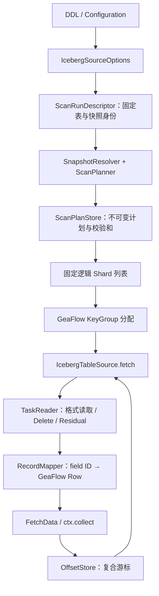

# GeaFlow Iceberg Connector 开发落地方案

> 归档日期：2026-10-24。文档性质：基于本地代码、指定书稿全目录及官方发布资料的设计评估；不是已实现、已通过测试或已获得性能数据的声明。
>
> GeaFlow 基线：`f8be72222ee1ddbbf66a87fc351cd727a4d13b03`。Iceberg 本地源码基线：`9299fe6926db7c09e2fe7f53e8129d994c37859c`，`git describe` 为 `apache-iceberg-1.11.0-692-g9299fe692`。本地 `book/` 为未跟踪文件；书稿中的源码行号不应当作发布版本兼容性证明。

阅读导航：

- 立项评审：第 1–6 节，范围、现状、兼容性和语义契约。
- 核心实现：第 7–14 节，架构、计划、offset、增量、类型、删除和配置。
- 上线执行：第 15–19 节，性能、测试、运维、后续 Sink 和工作包。
- 设计复审：第 20 节及附录 A–E，备选方案、逐篇阅读、勘误、证据和代码目录。

## 1. 决策摘要

建议新增 `geaflow-dsl-connector-iceberg`，沿用 Paimon 的 `TableReadableConnector → TableSource → FetchData<Row>` 接入形态，重新设计快照语义、任务分配和恢复协议。

推荐生产路线是 **JDK 17 + Iceberg 1.12.0 候选基线 + 独立 opt-in 构建与发行配置**。截至归档日，官方发布页列出的最新版本为 1.12.0；1.11.0 已将最低 Java 版本提升到 17。该版本选择仍须通过依赖、引擎运行和文件读取矩阵，才能冻结为上线版本。[官方发布记录](https://iceberg.apache.org/releases/)、[1.11.0 Java 基线说明](https://iceberg.apache.org/blog/apache-iceberg-1.11.0-release/)

分阶段交付：

| 阶段 | 交付能力 | 上线承诺 |
| --- | --- | --- |
| P0：兼容性与恢复原型 | JDK/依赖闭环、SPI、真实任务读、计划持久化、跨进程恢复验证 | 通过后才开始主体开发，预计 1–2 人周 |
| P1：生产批读 | 固定快照、时间旅行、Parquet、v1/v2、position/equality delete、稳定并行、窗口恢复 | 对声明的类型、Catalog、存储组合提供生产支持，预计 4–6 人周 |
| P2：生产追加增量 | `(start, end]` 有界增量、全量后持续追加、严格 ancestry 校验、共享发现进度 | 只消费追加；发现不支持的变更明确失败，预计 3–5 人周 |
| P3：高级读取 | v3 DV、默认值、按门禁扩展类型/格式、REST 高级能力、下推优化 | 每项有独立兼容矩阵；不把 v3 解析能力等同于完整 v3 支持，预计 3–5 人周 |
| P4：写入与 CDC | 全局提交协议、append Sink；之后再评估 upsert/变更流 | 完成引擎级提交协调后单独发布；不纳入 P1/P2 工期 |

这里的“生产可用”指方案覆盖上线所需的设计和验收，不表示当前代码已经具备这些能力。P1/P2 不提供端到端 exactly-once 声明。Source 提供固定计划下的确定性重放；链路一致性还取决于 offset 后端、窗口恢复和下游提交行为。

### 1.1 不变量

1. 同一次全量扫描的所有 Worker 使用同一个确定的快照；重启不能重新解释 `latest`。
2. 一条计划中的文件区间只属于一个逻辑分片；分片身份不随 Worker 序号变化。
3. offset 指向“下一条尚未返回的数据”，并携带恢复所需的计划、快照和 schema 身份。
4. 快照 ID 只作标识；禁止 `snapshotId + 1`、按数值大小推断先后、用行号差推断跨文件位移。
5. 所有读取都应用该任务关联的删除文件和行级残差；没有能力处理时失败，不能退化为裸读 Parquet。
6. 未知 format、未知类型、过期历史、分支回退、计划缺失均有显式策略，默认不跳过数据。
7. Catalog 连接、Reader、FileIO 的生命周期有明确所有者；运行资源不进入 checkpoint。
8. 不改变现有 JDK 8/11 默认发行物的最低运行要求；新版 connector 进入专用 JDK 17 发行配置。

## 2. 分析范围与证据使用方式

实际检查了 Paimon 模块的全部 Java 文件、SPI、POM、测试，以及 connector API、Source/Sink 适配函数、OffsetStore、查询引擎、类型实现、构建 profile、CI 和 assembly。指定的 Iceberg `book/` 下 **27 篇正文、README、STYLE_GUIDE，共 29 个 Markdown 文件、11,353 行、521,751 字节**均已阅读；逐章提炼与冲突记录在附录 A、B。

证据优先级为：**目标发布 tag 的真实 API/测试与正式规范 > 当前本地源码 > 书稿解释 > 本方案推导**。正文将现状、建议与待验证项分开。文中的 `IcebergTaskReader`、`ScanRunDescriptor`、`ScanPlanStore` 等均为建议新增的 GeaFlow 类，不是已有类或 Iceberg 公共 API。

源码引用索引见附录 C。归档文件用绝对路径链接，便于当前工作区点击；对外提交时可在另一版文档中转换为仓库 permalink。

## 3. Paimon 实现：可以借鉴什么，必须重做什么

### 3.1 已有链路

```text
WITH(type='paimon', ...)
  → ConnectorFactory / ServiceLoader
  → PaimonTableConnector.createSource()
  → PaimonTableSource.init(conf, TableSchema)
  → 规划侧 open → listPartitions(parallelism) → close
  → 序列化 SourceFunction / TableSource
  → Worker open → listPartitions → 按名称的 KeyGroup 分配 → setIndex
  → 每窗口 fetch(partition, persistedOffset, fetchWindow)
  → 逐行 ctx.collect → 写下一窗口 offset
```

`PaimonTableConnector` 只实现 `TableReadableConnector`，没有 DSL `TableSink`。`geaflow-store-paimon` 和图物化链路里的 `PaimonGlobalSink` 是另一层能力，不能用它们证明 DSL Paimon connector 已有通用 Sink 或完整 exactly-once。[Paimon 入口](/Users/kaori/Documents/gitrepo/tugraph-analytics/geaflow/geaflow-dsl/geaflow-dsl-connector/geaflow-dsl-connector-paimon/src/main/java/org/apache/geaflow/dsl/connector/paimon/PaimonTableConnector.java)

### 3.2 审计结果

以下是代码可见的行为与风险；未在本次文档任务中执行 Paimon 故障复现，不能把风险一律表述为已复现事故。

| 代码点 | 观察及影响 | Iceberg 设计要求 |
| --- | --- | --- |
| `listPartitions(int)` / `PaimonPartition.getName()` | 创建 parallelism 个对象，但名称都为 `database-table`；运行时按名称哈希，可能集中在一个 Worker，并共享同名 offset 键 | 每个逻辑 shard 有唯一、稳定名称；不按 Worker 再次分流 |
| `reset()` 的 `hash % parallel` | Java 负余数可能无法命中非负 index；而前一层已按名称分配 | 用有版本的确定性哈希与 `floorMod`；只做一次归属分配 |
| `nextSnapshot()` | 直接 `snapshotId + 1` | Iceberg 必须沿 parent/ref lineage 或增量 API 遍历 |
| `loadSplitsFrom()` | 每次新建 `StreamTableScan` 并 restore；BATCH 也走此路径 | P1 使用固定快照的完整 live-row 扫描；增量另建模式 |
| Paimon batch 单测 | latest snapshot 测试期待最后一次追加的 5 行，而不是两次提交累计的 10 行 | Iceberg `snapshot` 必须表示选定快照的完整可见表状态；不能照搬测试预期 |
| `ALL_WINDOW` | 返回当前 iterator，offset 使用无参 `PaimonOffset`；代码没有在此分支串联所有 split | Iceberg ALL 遍历本 shard 全部任务，并返回明确 END offset |
| SIZE + BATCH | iterator 耗尽时 break，`isFinished` 只检查该 iterator；没有同 STREAM 分支一样推进后续 split | 只有 shard 全部任务完成才能 finish |
| restore 的 `Math.abs(...)` | 用局部行号差推导 skip，不包含文件/方向语义；缓存 iterator 也未统一重建 | 按持久计划定位指定 task，然后从 task 起点重放 |
| partition 可变身份 | `setIndex()` 会影响 equals/hashCode；`final transient splits` 依赖反序列化方式重新初始化 | shard DTO 不可变；对 Java/Kryo 两种路径做往返验证 |
| deserializer | 按位置取值，用 assert 检查列数，没有逐字段 null 分支；字符串返回 Paimon 类型 | 按 field ID 映射，显式校验与 null 处理，输出 GeaFlow 自身值类型 |
| `open()` 日志 | 打印完整 tableConf/options/configs | 脱敏并限制日志字段，避免凭证进入控制台和异常 |
| `close()` | 一个关闭异常可能中断后续清理；Catalog 是局部变量，缺少明确关闭归属 | 部分 open 失败也清理；聚合 suppressed exception；关闭幂等 |
| 单测范围 | 主要为并行度 1、少量基础类型、同实例 offset 重读 | 新增真实分布式、跨进程、删除/演进/故障/大计划测试 |

结论：复用 SPI、生命周期接口、配置风格和测试组织方式；不复制其快照、分片和恢复算法。Paimon 的上述问题可另开修复，不将修复整个 Paimon 模块作为 Iceberg 上线前置条件。

## 4. GeaFlow 集成约束与需要补齐的基础设施

### 4.1 规划阶段和运行阶段不是一次 open

`GeaFlowQueryEngine.createRuntimeTable()` 会 `init → open → listPartitions → close`，之后同一个 source 配置对象进入执行图，Worker 的 `GeaFlowTableSourceFunction.init()` 再次 open。当前还存在 `ISkipOpenAndClose` 分支，但不能仅为了避开生命周期问题就采用它。

设计为三个层次：

| 层次 | 内容 | 生命周期 |
| --- | --- | --- |
| `IcebergSourceOptions` | 不可变配置、secret 引用、投影约束 | init 后可序列化 |
| `ScanRunDescriptor` | runId、表身份、bootstrap 快照、schema、shardCount、计划根引用 | 规划后保存，close 不清除，恢复复用 |
| `IcebergSourceRuntime` | Catalog、Table、FileIO、Reader、缓存、线程池 | transient；每次 open 构建，close 释放 |

规划侧 open 首次确定 descriptor；Worker open 只加载该 descriptor，不能再次选择最新快照。自动 `latest` 是“提交这次扫描计划时最新”，不是每个 Worker 启动时最新。

**跨进程恢复的根引用也必须持久化。** 只放在 Java 字段中不足以应对执行图重建。P0 要验证提交系统能保存 descriptor；若不能，则增加 run metadata 持久化与恢复入口。生产模式要求部署提供稳定 runId 或恢复 token，任务重试加载原 descriptor；用户主动新跑生成新的 runId。这里不能直接以可复用的 jobName 代替运行实例身份。

### 4.2 分区名称就是调度和恢复身份

运行时 `assignPartition()` 对 `partition.getName()` 做 KeyGroup 分配；`OffsetStore` 的键也包含这个名称。后台约每 120 秒再次调用 `listPartitions()`，列表发生变化会让 Source 报错。因此：

- 不将不断变化的数据文件列表直接暴露成 GeaFlow Partition。
- 返回固定 K 个逻辑 shard，名称示例 `iceberg:<runToken>:<tableToken>:shard:00017`。token 使用规范编码，避免 `_` 拼接键和名称中引号处理产生歧义。
- `listPartitions()` 和 `listPartitions(int)` 都返回相同身份、同顺序的不可变 shard 列表；不得依赖实参 parallelism 改变 K。
- `Partition.setIndex(workerIndex, parallelism)` 仅记录诊断信息或为空操作，不改变 identity、hashCode 或 task 归属。
- 文件 split 归属使用 `shardId = floorMod(stableHash(canonicalTaskKey), K)`；GeaFlow 再把 shard 分配给 Worker。禁止叠加 `hash % workerParallelism`。
- K 与 Worker 数 P 分开配置，例如 K=64、P=4；不同 shard 映射同一 KeyGroup 属正常现象，性能不保证完美均匀。固定 maxParallelism，并在压测中验证倾斜。

P1 不宣称支持在线 rescale。重启改变 P 时，须验证 offset 后端共享状态可达、maxParallelism 固定、所有 shard 恢复一次；未通过之前拒绝该操作。改变 K 属恢复协议变更，需要新扫描或显式迁移。

### 4.3 OffsetStore 不等于跨算子事务

当前 SourceFunction 是“把 fetch iterator 全部 collect 后，写 `batchId + 1` 的 offset”；OffsetStore 使用 Kryo 保存对象，并按 batchId 对 bucketNum 取模，维护缓存和控制台简化数值。它没有在此方法中与任意下游 Sink 构成原子事务。

P0/P1 必须验证以下场景：已 collect 未写 offset、写 offset 后下游失败、窗口并发重放、bucket 环形复用、整个进程重启、JDBC 后端恢复。生产部署使用项目已验证的持久 offset 后端，不能使用 MEMORY 承诺宕机恢复。

`Offset.getOffset()` 只提供控制台展示值，不能装下复合游标。建议返回 shard 累计返回行数，`humanReadable()` 展示 run/snapshot/task/ordinal；算法只能使用完整 DTO。不将 snapshotId 映射成“连续进度”。

### 4.4 引擎级精度障碍

当前 `TimestampType.serialize()` 只写 `Timestamp.getTime()` 的毫秒值，反序列化不能保留亚毫秒 nanos。因此，即使 Reader 正确读出 Iceberg 微秒时间戳，经过某些 GeaFlow 类型序列化路径后也会丢失精度。

P1 推荐先拒绝 TIMESTAMP 类型，或单列可选兼容模式并要求数据精度确实为毫秒；**默认不能静默截断**。正式开放微秒/纳秒精度之前，需要完成 common 类型、比较/哈希、DSL/Calcite 类型及状态序列化的配套设计和旧状态迁移。这个工作不能藏在 connector 的类型转换里。[TimestampType 证据](/Users/kaori/Documents/gitrepo/tugraph-analytics/geaflow/geaflow-common/src/main/java/org/apache/geaflow/common/type/primitive/TimestampType.java)

## 5. 版本、构建、依赖与发布方案

### 5.1 选择矩阵

| 方案 | 收益 | 代价与结论 |
| --- | --- | --- |
| JDK 8 + 老 Iceberg | 改动面小 | 无法覆盖近期能力与修复；不作为新生产 connector 主线 |
| JDK 11 + 1.10.2 候选 | 可作环境暂不能升级时的过渡 | 形成另一兼容分支，功能承诺需重新收窄；不与 1.12 混用 |
| JDK 17 + 1.12.0 候选 | 跟随近期维护线，可验证 v3/DV 和新的格式抽象 | 推荐；必须先解决 profile、旧依赖、部署镜像与引擎运行兼容 |
| 本地源码 HEAD 或 nightly | 可研究 v4/实验能力 | 不作为生产依赖，特性存在不等于已标准化或所有引擎可读 |

根 POM 默认 JDK 8，有 `jdk8`、`jdk11` profile；`jdk11` 自动激活区间为 `[11,)`。仅安装 JDK 17 不会自动形成正确的专用构建。建议新增 `iceberg-jdk17` profile，显式选择 compiler target、Enforcer 和模块；检查 effective POM，避免继承的 compiler execution 与 `jdk11` 叠加产生意外结果。

P1 先做 opt-in，默认 reactor 不包含该 connector，不把 Iceberg 的 JDK 17 类自动放入 JDK 8/11 通用 SPI 扫描 classpath。编译服务、Console 的版本类加载进程、Driver、Worker 和插件测试进程，只要加载该插件，都需运行 JDK 17。

### 5.2 依赖策略

模块直接使用 Iceberg Java SDK，不依赖 `iceberg-spark-runtime-*`、`iceberg-flink-runtime-*`，不嵌入 Spark/Flink 执行环境。

| 依赖 | 用途 | 管理策略 |
| --- | --- | --- |
| `iceberg-api` / `iceberg-core` | Table/Catalog/scan/metadata | 同一个固定版本 |
| `iceberg-data` | Record、通用格式模型、DeleteFilter | 同版本；内部实现变化封装于 adapter |
| `iceberg-parquet` | P1 数据文件读取 | 同版本；不能复用旧 file connector 的 Parquet Reader |
| `iceberg-orc` | P3 ORC | 独立开启并通过矩阵 |
| `iceberg-aws` + 经验证 SDK/bundle 组合 | S3FileIO | 按 profile 发布，禁止同时装两套重复 bundle/SDK |
| `iceberg-hive-metastore` | HMS Catalog | 可选；不直接继承现有 Hive connector 的整套依赖 |
| Hadoop 与认证相关依赖 | 本地/HDFS 与 Hadoop 配置 | 依 effective dependency tree 决定匹配版本，不盲信父 POM |

仓库已有 Hadoop 2.7.4、Guava 20.0、Jackson 2.11.2/2.13.4、file connector Parquet 1.10.1、AWS SDK 多条依赖线。不能简单加入 Iceberg 后依赖 Maven 最近路径规则。Iceberg 的 relocated Guava 也不解决所有 Jackson/Parquet/Avro/Hadoop 冲突。

推荐发布 **connector shaded artifact + geaflow API provided**：为 Iceberg 及其冲突的实现依赖规划独立命名空间，完整保留 SPI/反射资源，并检查默认实现类名、`io-impl`、Catalog 类名和服务加载。跨边界只暴露 GeaFlow 的 Row/Partition/Offset 与自有纯 DTO。不要 shade 出第二份 GeaFlow API，避免 ClassCastException。

shading 不是已证明可行的结论：P0 必须在真实 assembly 中验证同进程使用 file/Paimon/Iceberg 的无冲突加载。若反射/资源重写无法可靠闭环，选择真正隔离的插件类加载器并明确父子加载边界；当前已有 URLClassLoader 不足以证明这种隔离已存在。两条路线择一固定，不同时维护隐含回退。

### 5.3 发布必须改到的地方

1. connector 父 POM：在 opt-in profile 注册模块；统一 Iceberg 版本属性。
2. 新模块：API provided、固定依赖、测试依赖、shade、SPI、license/notice。
3. JDK 17 专用集成测试模块：建议 `geaflow-dsl-connector-iceberg-tests`，依赖 runtime 与 connector，避免被现有 Hive 测试模块的 JDK 限制绑住。
4. assembly：profile 直接增加新插件 artifact，确认 ServicesResourceTransformer 合并完整。仅加 `<module>` 不会自动进入发行包。
5. Docker/部署脚本：专用 JDK 17 镜像与插件分发；Console 编译进程也验收。
6. CI：新增 JDK 17 编译/运行/集成作业，同时保留现有 JDK 8/11 回归。
7. 文档：中英文 connector 指南、配置表、支持矩阵、迁移说明和操作手册。

## 6. 能力与语义契约

### 6.1 模式命名及边界

以下是新 connector 的建议配置语义，不是现有 GeaFlow 已有的选项。

| mode | 输入边界 | 输出 | 有界性 |
| --- | --- | --- | --- |
| `snapshot`，默认 | latest / snapshot-id / as-of-timestamp / ref 四选一 | 选定快照的全部可见行 | 有界 |
| `incremental-append` | start exclusive、end inclusive，必须在同一祖先链 | 该区间内追加的新数据 | 有界 |
| `streaming-append` + `snapshot-and-follow` | 固定 bootstrap 快照 S0 全量；再消费 S0 之后追加 | 全量一次 + 未来追加 | 无界 |
| `streaming-append` + `after-snapshot` | 指定 S0，不读 S0 本身 | `(S0, …]` 的追加 | 无界 |

不使用含糊的 `latest` 表示两种流启动方式。P2 首版不额外实现 earliest、按时间启动、动态切换分支等多组交互组合。tag 可用于有界 snapshot；流只允许真实 branch，默认 main。

snapshot 例子：S1 加 A/B，S2 加 C，S3 删除 A 的一行。读取 S3 应输出 A/B/C 当前仍可见的行，不是只读 S3 新写的文件。显式指定不存在或已过期的快照立即报错；不会退到 latest。

### 6.2 表格式门禁

| 能力 | P1 | P2 | P3/未来 |
| --- | --- | --- | --- |
| v1/v2 完整快照 | 支持 | 支持 bootstrap | 保持回归 |
| v2 position/equality delete | 必须正确应用 | bootstrap 支持；后续新增删除拒绝 | 支持更大删除集治理 |
| v3 DV、旧 position delete 与 DV 演进 | 默认拒绝整个 v3 表 | 默认拒绝 | 开关验证后逐组合发布 |
| v3 row lineage / defaults | 默认拒绝，不推断 | 同左 | 单独映射与测试 |
| v4 Parquet manifest / typed stats / relative paths | 拒绝 | 拒绝 | 实验研究，不作 GA 承诺 |

正式规范已采纳 v1/v2/v3；v4 仍处于开发阶段。即使 1.12.0 的 TableMetadata 常量允许 v4，也不能据此开放生产支持。[正式表规范](https://iceberg.apache.org/spec/)、[1.12.0 TableMetadata](https://github.com/apache/iceberg/blob/apache-iceberg-1.12.0/core/src/main/java/org/apache/iceberg/TableMetadata.java)

format-version 属于保留元数据，不能假设总能通过 `table.properties().get("format-version")` 取得，更不能缺失就当作 v2。P0 的版本 adapter 要从 SDK 的真实 TableMetadata/明确能力入口读取并校验；对所选 Catalog/Table 实现无法可靠判定时直接拒绝，不以默认值绕过门禁。每个新流 epoch 也重新检查格式与 schema 兼容，防止运行中被其他 writer 升版。

### 6.3 追加流不是 CDC

P2 默认采用严格模式：只接受经过校验的纯 APPEND；DELETE、OVERWRITE、新增/删除 delete file、ref 回退/重指向都失败并保留最后有效 offset。REPLACE/compaction 首版同样失败，避免未经证明就跳过维护操作。之后可对经认证 writer 的纯行保持 rewrite 增加显式兼容开关，要求数据逻辑集合和追加结果的专项测试。

不能依赖 IncrementalAppendScan 本身发现所有非法操作：检查过的本地实现仅收集 APPEND 快照，其他 operation 可能被忽略。connector 必须先遍历完整区间做业务语义校验，再调用增量规划。

Iceberg 的新增文件、删除文件、row lineage 或 changelog scan 均不能直接等同于有主键、before/after 配对的业务 CDC。现有 Row 接口没有通用 RowKind 变更协议；涉及图中顶点/边删除，还需定义图更新语义、幂等键、事件顺序和状态撤回。因此 CDC 单列 P4，不通过“每个快照做 diff”暗中提供。

## 7. 推荐架构与类职责



| 建议类 | 单一职责 | 状态与边界 |
| --- | --- | --- |
| `IcebergTableConnector` | getType=ICEBERG，创建 Source | 只实现 readable |
| `IcebergSourceOptions` / `IcebergConfigKeys` | 类型化解析、互斥/范围校验、脱敏 | 不保存已解析 secret |
| `IcebergCatalogLoader` | Catalog、会话和 FileIO 生命周期 | 不可跨作业共享凭证缓存 |
| `SnapshotResolver` | latest/id/time/ref → 固定 snapshot；验证 ancestry | ID 不作顺序比较 |
| `ScanRunDescriptor` | 恢复根身份、schema 与兼容版本 | 纯 DTO，持久化 |
| `IcebergScanPlanner` | 扫描规划、split、排序、归属、计划发布 | 所有 CloseableIterable 正常关闭 |
| `ScanPlanStore` | 原子发布计划、读取 shard 页、checksum、保留策略 | 新增基础设施，非现成 OffsetStore 能力 |
| `IcebergPartition` | 固定 shard 身份 | equals/hashCode 不依赖 Worker |
| `IcebergOffset` / `IcebergOffsetCodec` | 复合恢复位置与格式版本 | 不保存 Reader/Table/Catalog |
| `IcebergTaskReader` | 消费一个完整 FileScanTask | 应用 delete 与 residual，暴露关闭 |
| `IcebergRecordMapper` | 按 ID 投影到 ObjectRow | 深拷贝可变值，不返回 Iceberg 对象 |
| `IcebergTableSource` | 生命周期、窗口与上述组件编排 | 缓存只用于加速，持久 offset 是恢复依据 |
| `IcebergScanMetrics` | 对接 GeaFlow MetricGroupRegistry | 限制标签基数 |

### 7.1 Reader 的真实 API 边界

`IcebergGenerics.read(table)...build()` 适合快速正确性对照和单线程原型；每个 Worker 都调用一次会重复全表读取，而且它的 ScanBuilder 不接收任意已分配 FileScanTask。

本地及已核对的 1.12.0 `GenericReader` 类本身是 package-private，不能在 GeaFlow 中直接 `new GenericReader(...)`。建议自建很薄的 TaskReader，复用公开的格式读取接口和 `GenericDeleteFilter`，对准固定发布版本测试；不把类放进 `org.apache.iceberg.*` 绕过可见性。

推荐执行次序：补齐 delete 所需列和绝对 row position → 读指定 file range 并注入 identity partition 常量 → 应用删除 → 评估残差 → 投影/转换到 DSL 行。版本 adapter 是升级维护边界。[1.12.0 GenericReader](https://github.com/apache/iceberg/blob/apache-iceberg-1.12.0/data/src/main/java/org/apache/iceberg/data/GenericReader.java)、[公开 GenericDeleteFilter](https://github.com/apache/iceberg/blob/apache-iceberg-1.12.0/data/src/main/java/org/apache/iceberg/data/GenericDeleteFilter.java)

内部 read schema 至少包含输出列、residual 引用列、delete key 与位置列、所需 identity 常量；它与最终 ObjectRow schema 分开。Reader 缩列后仍能过滤、过滤后不会输出额外内部列，都应以 fixture 验证。

不要将发布说明中 Avro 的 `PlannedDataReader` 误认作“可直接读分布式 FileScanTask 的通用公共 Reader”。具体构造方法、格式模型注册和 name mapping 传递必须在 P0 编译原型中确认。

## 8. 扫描计划与并行任务设计

### 8.1 固定快照规划

1. 加载 Catalog 和 Table，确定表的真实身份；v2+ 使用 UUID，v1 缺少 UUID 时采用配置的 catalog+identifier+受管 incarnation 指纹，并限制透明 drop/recreate。
2. 解析选择器，得到 S0 或明确的 EMPTY 标记。latest 的无快照空表是合法空结果；显式 ID/time 在范围外是错误。
3. 冻结读 schema、field ID 映射、partition spec 集合、name mapping、大小写策略、过滤表达式、分片数和 split 参数。
4. 对固定快照调用 scan 规划。按格式支持的安全边界 split，产出原子 FileScanTask；不按任意字节数切开 Parquet 页。
5. 为每个 task 创建稳定 key、排序并分配固定 shard；大计划使用分片页，不能 `collect(toList())` 装入执行图。
6. 原子发布 plan root；只有 root READY 后允许 Worker 消费。规划失败不发布半个计划。
7. close 规划侧临时资源，保留 descriptor 引用。

基本 API 选择是 TableScan 的 useSnapshot/asOfTime、planFiles/planTasks；真正的 split/读取实现以发布 tag 为准。[Iceberg Java 扫描 API](https://iceberg.apache.org/docs/latest/api/)

### 8.2 任务身份、排序与 payload

建议 canonical task key 包含 `tableIdentity + snapshotId + specId + exactFileLocation + start + length + contentType`；task payload 另带 DataFile、DeleteFile 描述、schema/spec、residual 和 name mapping。完整 payload 的 hash 再进入 plan checksum。

路径按 Iceberg/FileIO 语义原样处理，不能任意 URI normalize：签名、特殊字符、重复分隔符以及未来相对路径可能改变语义。P1 只接受被批准的绝对 URI。checksum 算法、字段顺序、字符编码、哈希归属算法都要有版本。

先固定原子 task，再按 key 排序和分片；不依赖 Manifest 并行迭代次序、HashMap 顺序或 CombinedScanTask 的临时装箱顺序。CombinedScanTask 可作读取合批优化，但 checkpoint 单位仍可定位原子 task。缓存 entry/file 引用前使用 copy，防止容器复用使所有描述变成最后一个文件。

DTO 的序列化使用显式版本的 envelope 和校验和；不要把 Iceberg 内部实现类的 Kryo 字节当长期计划协议。需要利用 Iceberg JSON/解析工具时必须验证目标类型可完整往返，尤其 delete file 的 sequence、equality IDs、key metadata、DV 范围和 residual。缺字段不能用默认值蒙混恢复。

### 8.3 持久计划存储

推荐 `JDBC 原子索引 + 共享对象/文件存储的不可变计划页`。新增索引至少记录 runId、tableIdentity、epochId、parentEpoch、snapshot/range、rootUri、checksum、READY 状态、codecVersion 和 plannerVersion。

- 同一 `(runId, epochId)` 唯一；先写不可变页，最后以事务/CAS 发布 root。
- 多个候选 planner 竞选同一 epoch 时只有一个发布成功；其他读取胜出计划，不能用自己不同的分页结果推进 offset。
- 运行端按需读取自身 shard 的页；页缺失、checksum 错误、版本不匹配直接失败。
- index 凭证与数据凭证分别管理；对象存储使用条件写或唯一页名，不能以 S3 rename 模拟原子发布。
- 计划页不是表文件；只需对独立 plan prefix 写权限，Source 不需要 Iceberg 表的修改权限。
- 计划保留时间覆盖所有可恢复窗口、停机和运维回放期限；GC 参考活跃 run/恢复 token，不能只按文件年龄清理。

小表开发环境可内嵌受限计划，例如 root payload 不超过 4 MiB；生产超限必须使用共享存储或明确拒绝。初始建议 `max-planned-tasks=100000`、规划内存上限 256 MiB，均为待压测的保护阈值，不是 Iceberg 默认值或性能结论。

### 8.4 空 shard 与空表

K 个 shard 保持存在，即使其中没有 task。bounded 的空 shard 返回空 iterator + END + finish=true；无界流中的无任务 shard 返回空数据 + 合法进度 + finish=false。不能将“本 Worker 当前没分到文件”当成整张流表结束。

没有首快照时，streaming 的 bootstrap descriptor 保存 BEFORE_FIRST；后续看到首个合法快照，再按约定规划首次追加。不得用 `snapshotId=1` 假设首个快照。

## 9. Offset 与窗口读取：恢复算法

### 9.1 建议状态结构

```text
IcebergOffsetV1
  codecVersion
  runId / descriptorHash
  tableIdentity / refName / branchIncarnation
  mode / phase = BOOTSTRAP | APPEND | END
  shardId / shardCount / assignmentVersion
  epochId / planRootUri / planChecksum
  snapshotId / completedSnapshotId / parentSnapshotId
  schemaFingerprint / projectionAndFilterFingerprint
  nextTaskKey / nextTaskIndexWithinShard
  visibleRowsConsumedInTask
  totalRowsReturned
```

`visibleRowsConsumedInTask` 定义为“该固定 task 经删除过滤和残差过滤后，已经返回的行数”。它不是物理文件行号、字节 offset、全表行号或事件时间。END 状态不通过某个快照 ID 哨兵值表达。JSON/二进制 envelope 要支持明确的版本迁移或拒绝，不把新增字段任意变成零。

把 `nextTaskIndex` 当索引优化，把 `nextTaskKey + checksum` 当身份验证；仅有数组下标在重新规划后不可靠。`OffsetStore` 的真实 Kryo serializer 必须参与 round-trip 测试，不能只测 DTO 自己的 JSON。

### 9.2 fetch 契约

```text
fetch(shard, requestedOffset, window):
  1. requestedOffset 优先；没有时使用 run descriptor 中该 shard 的起点
  2. 校验 run/table/ref/K/codec/schema/filter/plan 身份
  3. 若运行时 Reader 游标与 requestedOffset 不一致：关闭旧 Reader
  4. 从指定 task 起点打开，重放 visibleRowsConsumedInTask 行
  5. 逐 task 读取，应用 delete/residual，再映射成独立 Row
  6. 达到窗口边界或 shard END；跨 task 时及时关闭前一 Reader
  7. 返回数据和代表下一条未返回行的不可变 nextOffset
  8. SourceFunction 消费完成后写 offset；缓存不能越过持久恢复点
```

任何传入的旧 offset 都必须能重放。不能在 offset 相等时就假设内存 Reader 状态一定一致；异常中断可能已经推进了内存状态。建议 Reader 缓存携带精确 cursor，失败后作废；重新 fetch 从调用方 offset 恢复。禁止 `Math.abs(new-old)`。

如果重放到指定 visible ordinal 前 Reader 已 EOF，应报 PLAN_OR_CURSOR_MISMATCH，不能少跳几行后继续。delete/residual/投影策略是计划的一部分；不能使用“当前配置”重新过滤旧任务。

### 9.3 窗口支持

| 窗口 | P1/P2 行为 | 资源与进度 |
| --- | --- | --- |
| ALL + bounded | 用惰性串联 iterator 消费 shard 的全部 task；返回不可变 END offset，只有 iterator 正常耗尽后才由框架保存 | 不把全表放 List；中途失败从当前持久窗口起点重放 |
| SIZE | 每次最多返回该 partition 约定的 N 行，跨 task 读取 | 返回完整 nextOffset；所有 task 耗尽才 finish |
| ALL + streaming | 拒绝 | 无限 iterator 无法完成一个窗口和持久 offset |
| TIME | 首版拒绝 | 需要可取消/有上界的 IO 时间控制与窗口契约后再实现 |

当前框架对每个 Partition 都传入相同 SizeFetchWindow，N 并非天然“一个 Worker 总共只读 N 行”。K 个 shard 可能在一个 Worker 一轮产生多份 N；文档、吞吐估算和测试都应按真实框架语义。若要支持 Worker 总预算，应单独扩展 SourceFunction，不能只在 connector 内私自改变窗口含义。

SIZE fetch 增加独立的批内存限额，例如 64 MiB。没有空间放下一行时保留可重放游标，下次处理；单行已超过上限则明确失败。不要让“达到字节预算”变成丢弃已读未返回行。ALL 的 iterator 在 EOF、映射异常和 close 时都应关闭底层资源；框架中途停止时由 source.close 兜底。

### 9.4 恢复的性能边界

首版恢复允许“重新打开 split，顺序跳过已返回行”，它是正确性优先的 O(该 split 已消费行数) 方案。split 目标初值可设 128 MiB，限制最坏重放成本。该值不能限制单个 row group 的实际大小，也不限制展开后的内存。

后续可以引入格式专用 row-group/page cursor，但要求兼容删除位置、过滤与 Reader 版本，单独升级 offset codec。不要承诺随机按行 seek：Parquet 文件不是可直接用行号定位的数组。

### 9.5 必测故障点

| 故障点 | 正确结果 |
| --- | --- |
| Reader 已读，Row 尚未返回 | 下次从旧 offset 重读，无丢失 |
| FetchData 已返回，ctx.collect 中断 | 保留旧持久位置；允许下游重放，不能承诺所有 Sink 自动去重 |
| collect 完成，writeOffset 失败 | 持久位置不确定时失败并按引擎恢复；不可靠缓存宣布成功 |
| offset 已写，后续算子失败 | 由窗口恢复协议协调；P0 的一致性验证必须覆盖 |
| task 尾部最后一行、恰好 N 行 | 正确切换到下一 task 或 END，不重复末行 |
| 进程重启、Reader/缓存全部丢失 | 只依 descriptor + offset + plan 页即可恢复 |
| 计划存储读到半成品/坏 checksum | 拒绝消费，不重新选择 latest |

## 10. 追加增量与流发现

### 10.1 bootstrap 与 follow 的衔接

`snapshot-and-follow` 先消费固定快照 S0 的完整可见状态，bootstrap 每个 shard 的 END 与增量起点 S0 一并保存。之后从 S0 exclusive 开始，避免把 S0 的追加文件读两次。各 shard 可独立完成 bootstrap，但发布的增量 epoch 序列由同一个 run 元数据约束。

本方案中的 `branchIncarnation` 是受管运行的校验字段，不是声称 Iceberg 有稳定的“分支 UUID”公共 API。仅轮询 metadata 无法识别两轮之间 ref 被删后又重建到完全相同 lineage 的短暂事件；若业务要求检测这种事件，需要 Catalog 审计/变更版本或平台约束禁止重建。SDK 可见的 ref 缺失、类型改变与非祖先重指向必须被检测。

每轮发现：

1. refresh 分支头 H，读取持久化的最后发现位置 L。
2. 沿 H 的 parent 链回溯到 L，确认历史完整、属于目标 branch 的当前祖先链；反转为提交顺序。
3. 对全部中间快照校验 operation 和新增/删除文件类型；不只看 H。
4. 对每个合法 snapshot 构建固定增量计划，边界为 `(parent, snapshot]`，并以发布版本的 IncrementalAppendScan API 规划。
5. 第一个 snapshot 无 parent 时，采用该 API 的明确 inclusive 起点能力或经过验证的首快照全量路径；不要传入伪造 ID=0/1。
6. 发布 epoch 和状态后，Worker 读取分配的 tasks；已完成的 shard 进度逐窗口保存。
7. 只有该 shard 完成当前 epoch，才推进其 completedSnapshotId；发现位置可以领先消费位置，但不能丢弃未完成计划。

有界增量固定 end snapshot，所有 shard 完成 `(start, end]` 后结束；`start==end` 是合法空区间。若配置互不为祖先的边界，提交任务前报错。

### 10.2 不混淆三种进度

| 进度 | 含义 | 持久化内容 |
| --- | --- | --- |
| discovered | 已检查、已发布计划到哪个 snapshot | epoch 链及 plan root |
| assigned | 哪些 epoch/task 可由哪个 shard 读取 | 固定 assignment；不是 Worker 内存队列 |
| consumed | shard 已返回并被框架保存到哪里 | 复合 Offset |

“发现了 S10”不代表“已消费到 S10”。无数据 epoch 也要记录合法推进，避免不断扫描相同空快照；流式空窗口保持 finish=false，使用退避控制请求频率。

### 10.3 发现协调与扩展

P2 推荐在 connector 内新增 `ScanPlanCoordinator`，使用第 8 节的 JDBC registry 进行 lease/fencing/CAS。单个 lease holder 规划新 epoch，其他实例只读；lease epoch 必须进入写入前置条件，旧 holder 不能覆盖新 holder 的结果。完整计划 READY 后才更新发现位置。

这不是宣称 GeaFlow 已有 FLIP-27 Enumerator。若希望复用引擎调度服务，可在后续抽象统一 Enumerator SPI，但要按独立引擎变更审查。不得直接把 Flink Enumerator 类移植进来而忽略状态回调差异。

小规模实验可每个 Worker 独立规划，再用确定性 key/CAS 共享胜出结果；生产大表不采用该方式，原因是 Catalog/Manifest 开销接近 P 倍。需要限制 `max-snapshots-per-poll`、单轮计划大小和 pending epochs，背压时暂停发现，不能无限堆积任务。

初始调优值建议：poll=30 秒、一次至多 100 个 snapshot、规划线程 4、单轮计划总时间 120 秒。均为 connector 建议起点，应依 Catalog 配额与新提交频率压测，不作为 Iceberg 官方默认值。

### 10.4 异常决策

| 情况 | 默认处理 | 原因 |
| --- | --- | --- |
| H==L | 空轮询、退避 | 没有新数据 |
| H 的 lineage 不含 L | 停止、保留 offset、告警 | 可能 rollback、分支切换或历史断裂 |
| 锚点/中间历史过期 | SNAPSHOT_HISTORY_EXPIRED | 不能证明区间完整，不可自动跳到 latest |
| ref 被删除/重建 | REF_CHANGED | 同名不代表同一消费 lineage |
| table 被 drop/recreate | TABLE_IDENTITY_CHANGED | identifier 复用不代表原表 |
| DELETE/OVERWRITE/未批准 REPLACE | NON_APPEND_SNAPSHOT | 不能把表变更转换为追加流 |
| Credential 临时过期 | 刷新后有限重试 | 保留同一 plan 和 cursor |
| 存储对象确实缺失 | DATA_FILE_MISSING | 不能用空 iterator 掩盖数据损失 |

若业务一定要在历史缺失后重新全量，应创建新的 run，并对下游去重/覆盖/图重建作出显式操作决策。这个流程不是透明自动恢复。

## 11. Schema 与类型映射

### 11.1 绑定过程

DSL schema 没有 Iceberg field ID。init 先保存声明，加载表后按精确列名绑定到选定读 schema 的 ID，持久化 `dslPosition → fieldId → expectedType`。普通 snapshot 的 latest 使用冻结的当前读 schema；显式历史 snapshot 默认使用其 schemaId 对应的历史 schema。老 snapshot 无 schemaId 时采用 SDK 的兼容策略并在 descriptor 记录实际结果。

`newScan().useSnapshot(S)` 本身不应被假定为自动选择所有期望的历史 schema；必须显式构造投影并验证。ref 也存在差异：branch 通常跟随表当前 schema，tag 使用绑定快照 schema。本方案的 bounded 查询最终都冻结实际解析结果。

跨运行 rename：运行中的映射按 ID 保持稳定，删列再加同名列获得新 ID，不能自动接到旧映射。新增声明列缺失默认失败；仅当旧数据文件按 Iceberg 演进语义缺少已绑定列时，由 SDK 填 null/default。大小写不敏感模式需检测歧义并失败，不选择第一个匹配列。

### 11.2 首版支持矩阵

| Iceberg 类型 | GeaFlow 输出 | P1 规则 |
| --- | --- | --- |
| boolean | Boolean / Types.BOOLEAN | 支持 null；required 与 DSL nullability 校验 |
| int | Integer / Types.INTEGER | 支持；到 BYTE/SHORT 不默认缩窄 |
| long | Long / Types.LONG | 支持；不转 double，不接受溢出缩窄 |
| float / double | Float / Double | 支持；NaN、±Infinity、-0.0 专项验证 |
| string | 自有 BinaryString 或 String | 按 DSL 类型输出；不能返回 Utf8/Paimon BinaryString |
| decimal(p,s) | BigDecimal | 有条件支持；按 DSL/Calcite 精度与 scale 校验，拒绝自动舍入 |
| date | java.sql.Date | 有条件支持；用 LocalDate 语义转换，所有进程固定同一时区并验证状态往返 |
| timestamp / timestamptz | 需统一 Timestamp 精度/时区模型 | P1 默认拒绝，原因见 4.4 |
| time / uuid / fixed / binary | 需要明确 DSL 表达与序列化 | P1 默认拒绝；不能一律 toString |
| struct/list/map | 递归 Row/Array/Map 与状态类型 | P1 拒绝；仓库存在 Struct/Array 并不代表完整类型链路可用 |
| unknown / variant / geometry / geography / timestamp_ns | 新类型与元数据约束 | P3 后独立设计，不复用 Object 黑盒强行开放 |

int→long、float→double、decimal 扩精度且不改 scale 可以作为显式安全提升；还要验证 DSL 目标能容纳，而不是 Iceberg 允许提升就默认通过。null 必须先检查再解包，不使用 assert 承担生产校验。

对 char buffer、ByteBuffer、嵌套值和 Record 容器做必要深拷贝；禁止把复用的 Reader 对象直接塞进多个 ObjectRow。默认先关闭容器复用优化，性能验证后再开放。

### 11.3 隐藏分区与 TableSchema

GeaFlow `TableSchema` 合并 dataSchema 和 partitionSchema，而 Paimon deserializer 只处理 dataSchema。Iceberg 的 `days(ts)`、`bucket(id)` 是表内部布局，不应让用户额外声明成 DSL 业务字段，也不能按目录名补业务列。

P1 推荐 DSL 不声明 `PARTITIONED BY`；所有业务字段来自读 schema。需要支持 DSL 分区字段声明时，要求它确实对应可读业务列，显式处理最终行顺序；否则报错。identity partition 常量可由 SDK 用于恢复省略在数据文件中的原列值，但内部的 day/bucket 结果不自动输出成新业务列。

分区演进要按每个 task 的 specId 解释。不能对历史文件套用 `table.spec()` 的最新变换，也不能认为同名分区值一定跨 spec 可直接相等。

## 12. 删除语义与格式读取

### 12.1 P1 必须应用 v2 删除

FileScanTask 已关联适用的 delete files。TaskReader 不能把它降级成“路径 + 字节区间”。需要保留并读取 equality IDs、sequence、分区信息和位置列；即使 SELECT 没有 equality key，也要在内部 read schema 补齐，处理完删除后再投影出去。

P1 的数据文件与 position/equality delete 文件支持集合均先限定为经 fixture 验证的 Parquet。规划时同时检查 data format 和 delete format；业务数据全为 Parquet 也不代表 delete 文件一定是 Parquet。若 equality key 已从当前 schema 删除，仍需按历史 schema/field ID 找回删除匹配所需的类型，不能因 DSL 不读该列就忽略这份 delete。

正确的序列号规则是：position delete 的数据序列号适用条件为 `dataSeq <= deleteSeq`；equality delete 为 `dataSeq < deleteSeq`。比较的是 data sequence，不是 file sequence。具体配对逻辑委托 SDK，不自写一个简化匹配器。

测试需要覆盖 equality null 匹配、同一提交 delete+insert 保留新行、跨 spec/global equality delete、delete key 未投影、多个 delete 文件叠加、一个数据文件拆多个 split、全删除、旧无 field ID 文件的 name mapping。

### 12.2 行位置必须是绝对文件位置

对于 position delete，若 task 从第二个 row group 开始，position 仍是整个数据文件的 0-based row position，不能从本 split 的 0 重新计数。残差过滤/row-group pruning 也不能改变其意义。

P0 原型必须证明选定格式 Reader 能正确生成这列。无法证明时先禁用该优化组合，或使用安全的完整文件任务并缩小支持范围；不能输出看似正常但漏应用删除的结果。

### 12.3 v3 与 DV 接入条件

DV 是某一数据文件的删除位置集合，通常以 Puffin blob 保存；同一快照中该文件最多一个 DV，还可能同时有 equality delete。新位置删除与旧位置删除的替换规则、DV checksum/范围读取和 sequence 均由目标 SDK 处理。

P3 开放条件：Spark/Flink 生成 fixture、DV+equality、v2 升 v3 后保留旧 position delete、DV 更新、跨 row group、坏 blob 校验、密钥/权限异常、重启恢复全部通过。不能用“SDK 能 parse metadata”替代这些验证。

v3 的 row lineage 是额外元数据列，不自动作为 GeaFlow 顶点 ID、业务主键或 exactly-once 去重键。initial-default 与 write-default 的不同用途须正确保留；不允许用 null 统一填充所有新增列。

### 12.4 格式与加密边界

P1 支持表中实际数据文件全为 Parquet 的组合；Manifest 使用 Avro 不代表要支持 Avro 业务数据文件。若同一 snapshot 混入 ORC/Avro 数据文件，首版在规划校验阶段拒绝整个查询，不能只读支持的那部分。

P3 可分别开启 ORC/Avro，要求所有 delete/residual/projection/split/恢复测试重跑。Table/FileIO 的加密层必须使用 SDK 的解密入口；不能丢弃 key metadata 后用普通 InputFile 打开。P1 对客户端加密、未验收的 KMS/列加密组合明确不支持；服务端存储加密按实际云权限矩阵验证。

## 13. Catalog、FileIO、认证与资源生命周期

### 13.1 首选部署组合

| 组合 | 定位 | 上线条件 |
| --- | --- | --- |
| REST Catalog + S3FileIO | 推荐生产主组合 | 认证、存储凭证刷新、endpoint/TLS、S3 兼容存储矩阵 |
| HadoopCatalog + 本地文件系统 | 单测与开发 | 不用于推导对象存储多写入者正确性 |
| HadoopCatalog + HDFS | 既有受管环境的可选项 | 底层提交语义、HDFS 认证、权限与 writer 组合验收 |
| HiveCatalog + HDFS/S3 | 复用既有 HMS | 单独依赖 profile、HMS/认证/版本兼容 |
| JDBC/Glue/Nessie Catalog | 后续扩展 | 依据实际场景加入，不在首版声称全覆盖 |

Catalog 负责表标识到元数据的解析；FileIO 负责实际文件访问。REST 并不要求数据在 HTTP 服务内，Hive Catalog 也不要求数据在 HDFS。不能把 `warehouse` 当作所有 REST 服务必需的文件系统路径：它可能是服务端定义的仓库标识。

本方案推荐 REST 是为了收敛客户端依赖与认证/治理入口，不采用书稿“多引擎只能用 REST”的绝对表述。HMS、Glue、Nessie 也有多引擎生态。HadoopCatalog 在对象存储上的核心问题是提交依赖的文件系统原语，不能归因于“所有 S3 LIST 仍然最终一致”。

### 13.2 配置分层

connector 配置、catalog properties、FileIO properties、Hadoop configuration 分四层解析，分别校验。公共层禁止 `type`/`catalog-impl` 相互冲突；自定义实现使用部署白名单，不允许普通作业任意反射载入未知类。

对于 REST，优先复用 SDK 的协议客户端、会话、namespace 编码、服务端配置合并和存储凭证下发机制；不要自己拼 REST URL 或绕开 Catalog 手工下载 metadata JSON。配置覆盖次序依目标 SDK/服务端协议测试，不能一律说“服务端所有配置总优先”。

### 13.3 身份与 secret

- DDL、执行图和 plan 页保存 secret reference 或凭证提供者配置；Worker open 时解析。
- 优先 workload identity/STS/受管 OAuth；REST 认证与数据存储访问分别验证。
- 对 vended credentials 的 scope、过期时间、续期、401/403、Worker 新开 Reader 的行为做集成测试；不能把短期 token 固化在 SerializableTable 或 offset 中。
- Catalog、FileIO、HTTP 客户端缓存按租户/身份隔离，不跨用户复用 Table 实例。
- 日志只保留脱敏的 catalog type、table、snapshot、plan、错误码；包含 token、secret、Authorization、session、签名 URL 的字段一律不原样输出。
- 最小权限：表数据和 metadata 只读；plan prefix 可写；registry/offset 按用途授权。Source 不创建表、不改表属性、不触发 expire/compaction。

### 13.4 close 与并发

建议资源顺序：当前 Reader/iterator → 其他缓存 Reader → 规划 iterable/线程池 → Catalog 持有的会话/FileIO。使用资源所有权约定，防止 Catalog 已关闭 FileIO 后又由另一个对象重复关闭共享实例。

close 幂等、允许 open 部分失败、聚合多个关闭异常；一个资源失败也继续释放其余资源。运行期的 partition 比较线程只调用无 IO 的固定 `listPartitions()`，不与 fetch 线程共享可变规划器。Catalog refresh/epoch 发现由协调路径控制；当前 Reader 的快照任务不被 refresh 就地替换。

## 14. 配置规范与使用示例

本节均为拟新增配置。前缀统一为 `geaflow.dsl.iceberg.`；不要在实现前把示例当作已经可运行的 SQL。

### 14.1 配置清单

| 后缀 | 默认/必填 | 校验和行为 |
| --- | --- | --- |
| `catalog.type` | 必填 | P1 允许 rest/hadoop；hive 随可选 profile |
| `catalog.name` | `iceberg` | 本地逻辑名称，不冒充全局表身份 |
| `catalog.uri` | REST/HMS 必填 | 协议与 TLS 校验 |
| `catalog.warehouse` | 依实现 | Hadoop 必填；REST 按服务端要求 |
| `namespace.json` | 必填，例如 `["sales"]` | 多级 namespace 用数组，避免直接按点拆分 |
| `table.name` | 必填 | 只表示表名；禁止隐式解释成 metadata table |
| `catalog.properties.json` | `{}` | Catalog 原生属性，白名单与敏感项引用 |
| `fileio.properties.json` | `{}` | 实际透传边界由 loader 定义并测试 |
| `hadoop.configuration.json` | `{}` | 仅 Hadoop conf 项，不与 Catalog 属性混杂 |
| `secret.ref` | 依认证 | 受管凭证引用，生产不内联明文 |
| `read.mode` | `snapshot` | 三种模式见第 6 节 |
| `scan.snapshot-id` | 无 | 与 time/ref 互斥；有界快照选择 |
| `scan.as-of-timestamp-ms` | 无 | epoch 毫秒；P1 仅 main 历史时间选择 |
| `scan.ref` | `main` | 显式 ref 与 ID/time 互斥；流必须 branch |
| `scan.start-snapshot-id` | 增量必填 | exclusive；不与 scan.snapshot-id 混用 |
| `scan.end-snapshot-id` | 有界增量必填 | inclusive；提交时冻结 |
| `stream.startup` | `snapshot-and-follow` | `after-snapshot` 必须指定 start |
| `stream.poll-interval-ms` | 建议 30000 | 正整数；加 jitter，避免空转 |
| `stream.max-snapshots-per-poll` | 建议 100 | 大于 0；受 pending 预算限制 |
| `stream.non-append-policy` | `fail` | GA 首版仅 fail，不提供随意 skip |
| `source.shard-count` | 建议 64 | >0；descriptor 固定，恢复不能改 |
| `scan.split-size-bytes` | 建议 134217728 | 固定进入 plan fingerprint |
| `scan.planning-threads` | 建议 4 | 有上界，避免抢占引擎线程 |
| `scan.max-planned-tasks` | 建议 100000 | 超限失败或使用已验收分页模式 |
| `scan.max-plan-memory-bytes` | 建议 268435456 | 不能用任务数代替实际内存约束 |
| `fetch.max-buffer-bytes` | 建议 67108864 | SIZE 窗口保护 |
| `plan.store.uri` / `plan.registry.ref` | 生产必填 | 共享计划页 + 原子索引的配置引用 |
| `scan.run-id` / `scan.restore-token` | 提交系统提供 | 新跑与恢复互斥；恢复根身份 |
| `schema.case-sensitive` | `true` | 不敏感模式歧义失败 |
| `feature.v3.enabled` | `false` | P3 完整验收后才开放 |
| `feature.v4.enabled` | 不提供 GA 开关 | 研究 profile 与生产发行物分开 |

补充约束：mode=snapshot 禁止 start/end/stream 配置；mode=incremental-append 禁止 time 与 bootstrap；after-snapshot 禁止含糊的 latest 起点；未知 key 在 connector 命名空间内默认报错，原生属性按明确透传区处理。

### 14.2 有界快照读取

```sql
CREATE TABLE IF NOT EXISTS iceberg_edges (
    src BIGINT,
    dst BIGINT,
    weight DOUBLE
) WITH (
    type = 'iceberg',
    geaflow.dsl.iceberg.catalog.type = 'rest',
    geaflow.dsl.iceberg.catalog.uri = 'https://catalog.example.internal',
    geaflow.dsl.iceberg.catalog.warehouse = 'production',
    geaflow.dsl.iceberg.namespace.json = '["graph"]',
    geaflow.dsl.iceberg.table.name = 'edges',
    geaflow.dsl.iceberg.read.mode = 'snapshot',
    geaflow.dsl.iceberg.scan.snapshot-id = '867530912345678901',
    geaflow.dsl.iceberg.source.shard-count = '64',
    geaflow.dsl.iceberg.plan.store.uri = 's3://geaflow-plans/iceberg/',
    geaflow.dsl.iceberg.plan.registry.ref = 'iceberg-plan-registry',
    geaflow.dsl.iceberg.secret.ref = 'iceberg-prod-reader',
    geaflow.dsl.window.size = '10000'
);

CREATE TABLE IF NOT EXISTS sampled_edges (
    src BIGINT,
    dst BIGINT,
    weight DOUBLE
) WITH (
    type = 'file',
    geaflow.dsl.file.path = '/tmp/iceberg-edges-result'
);

INSERT INTO sampled_edges
SELECT src, dst, weight FROM iceberg_edges WHERE weight > 0.5;
```

示例 ID 为占位值，需从目标表真实 snapshot 选择；runId/restore token 由提交系统传入。credential、S3 region/endpoint、并行度和持久 offset 后端在部署配置中补齐。`WHERE` 在 P1 保留 GeaFlow 侧过滤，不宣称已自动下推。

### 14.3 P2 模式配置差异

```properties
# 全量后持续追加：去掉 scan.snapshot-id，固定解析 main 的初始快照
geaflow.dsl.iceberg.read.mode=streaming-append
geaflow.dsl.iceberg.stream.startup=snapshot-and-follow
geaflow.dsl.iceberg.scan.ref=main
geaflow.dsl.iceberg.stream.poll-interval-ms=30000
geaflow.dsl.iceberg.stream.non-append-policy=fail

# 若改为指定快照之后开始，则 startup=after-snapshot，并设置真实 start ID
# 有界增量则 mode=incremental-append，明确 start exclusive 与 end inclusive
```

图导入使用现有 Table→Graph DSL 路径，新增 E2E 样例验证边方向、重复边和顶点 ID；不要求 Iceberg connector 实现图存储 SPI。顶点表和边表各自固定快照并不能自动构成跨表一致视图；生产导图需由上游发布一组经过验证的 snapshot ID，记录到同一个导图 run manifest。

## 15. 下推、性能与规模控制

### 15.1 分层推进下推

当前查询引擎只将可识别的 partition filter 交给实现 `EnablePartitionPushDown` 的 Source，没有通用“所有谓词 + 投影”下推接口。Iceberg hidden partition 需要原始数据列谓词，由 SDK 按各 spec 推导；不能把它简单伪装为 GeaFlow 的显式 partitionSchema。

| 步骤 | 实现范围 | 正确性约束 |
| --- | --- | --- |
| P1 | 读取 DSL 声明所需列；WHERE 仍由 GeaFlow 执行 | 保留 delete 内部列；不声称 SQL 投影已全部推到 Source |
| P3-A | 引擎增加可选的 filter/projection capability 与转换器 | 不影响旧 Source；支持与不支持的表达式分别返回 |
| P3-B | 比较、IS NULL、有限 IN、AND 子句转换到 Iceberg Expression | 对 SQL 三值逻辑、NaN、时区、decimal 的语义等价有测试 |
| P3-C | 分区/文件/row-group 剪枝，观测扫描统计 | 保留原始 GeaFlow 行过滤作为兜底，不因“文件可能匹配”移除过滤 |
| 后续 | 向量化、聚合/limit 下推 | 删除文件、截断 bounds、全局 limit 语义另证，不作为 P1 目标 |

不支持的 OR 子表达式不能丢一半后当成等价 OR；AND 可以只下推安全子项，原表达式仍在引擎执行。不自行实现 inclusive/strict projection 或 bounds 解码器，复用 SDK。

### 15.2 容量模型

需要分别测量而不是只看 rows/s：

- 规划：metadata JSON 大小、Manifest 数、task 数、SDK delete index 内存、plan 页大小、冷/热 Catalog 延迟。
- 数据：文件打开次数、请求数、读取字节、解压内存、删除集大小、输出 Row 分配和 GC。
- 恢复：每个 split 重放行数、下载计划耗时、过期凭证刷新、最慢 shard 的时间。
- 调度：K、P、maxParallelism 的分布，最大 shard/平均 shard 字节比，小文件的倾斜。

应用自己分页不保证 SDK 的 metadata/删除索引也有界；P0/P1 用 profiler 测其实际驻留内存，超出预算的组合拒绝准入。全局 equality delete 可能让每个 Reader 都加载大删除集，应设置大小/数量保护，后续按任务生命周期共享受限缓存。

粗略模型：`workerMemory ≥ readerBuffers + deleteIndex + rowBatch + planPageCache + engineState + margin`。文件压缩后 128 MiB 不能直接代入所有项。每个 Worker 的同时打开 Reader 首版限制为 1 或小的固定数量，跨 shard 顺序使用；并行预取是后续优化。

K=64 只是逻辑分片建议，不代表要启动 64 个 Worker。显式配置并验证 `geaflow.dsl.source.parallelism`、`geaflow.dsl.table.parallelism` 和 `geaflow.job.max.parallel` 的实际作用，防止 `numPartitions` 自动推导导致意外扩容。

### 15.3 性能验收基准

以下是建议 gate，需先固定机器、存储、网络、数据压缩率和目标工作负载后调整，不是已经测得的 SLA。

| 场景 | 数据设计 | 关注门槛 |
| --- | --- | --- |
| 正确性基准 | 同快照、同投影，外部 Spark fixture 或独立 SDK oracle | 行多重集合完全相等；不做 distinct 掩盖重复 |
| 标准批读 | 100 GiB、约 256 MiB 文件、P=1/4/8 | 吞吐稳定，无随运行时间持续增长的堆/线程/FD |
| 小文件规划 | 10 万文件、不同 Manifest 碎片程度 | 计划内存受限；超过配置阈值明确失败而非 Driver OOM |
| 删除压力 | 无删除/10% 删除/大量 equality key | 延迟与内存曲线可解释；不出现静默漏删 |
| 并行扩展 | 固定 K 与 maxParallelism，改变 P | 任务不重不漏；记录倾斜和吞吐提升，不假定线性 |
| 恢复 | 读取 10%/50%/99% split 时杀 Worker | 符合确定性重放；恢复时间不随整张表大小线性增长 |
| 长稳 | 72 小时追加、凭证轮转、Catalog 间歇错误 | 无资源累计；lag 可观测；不支持变更清晰失败 |

## 16. 测试与发布验收矩阵

### 16.1 测试分层

| 层级 | 建议位置 | 内容 |
| --- | --- | --- |
| 单元 | connector/src/test | options、resolver、offset codec、shard identity、映射、异常分类 |
| 本地 SDK 集成 | 同模块，临时目录 | 实际建表/写 Parquet/生成删除，再完整读取 |
| 服务集成 | 新增 JDK 17 connector-iceberg-tests | REST + MinIO/S3 兼容存储 + JDBC registry/offset；HMS 另 profile |
| GeaFlow E2E | 同独立测试模块 | 真 SourceFunction、多个 Worker、窗口、序列化、表→图/表→file |
| 发布验收 | 专用 assembly/container | SPI、依赖冲突、Console 编译、Driver/Worker 一致加载 |
| nightly | 独立环境 | 大数据、故障注入、72 小时长稳、升级恢复 |

沿用 TestNG 组织风格；临时目录用独立随机路径，fixture 结束清理自身资源。现有 ConnectorTester 可借鉴，但它使用固定 `/tmp/dsl/` 并可能清理共享路径；并行测试应隔离，不能原样并行复用。现有测试模块主要依赖 Hive，且 JDK 11 CI 当前排除相关模块，因此独立 JDK 17 集成入口是必要交付。

### 16.2 P1 阻断项

| 编号 | 测试 | 必须断言 |
| --- | --- | --- |
| B01 | SPI 大小写 ICEBERG/iceberg、未装插件、错误发行物 | 正常发现；不支持运行时给出清楚错误，不拖垮旧 connector |
| B02 | latest / explicit snapshot / time / tag / branch | 解析语义正确；互斥项、缺失 ID/ref、早于保留历史报错 |
| B03 | 规划后并发追加、延迟启动 Worker | 所有 Worker 仍读同 S0 |
| B04 | 多文件、多 row group、多个 spec | 全部读取，最后一个文件结束才 finish |
| B05 | K=1/7/64，P=1/2/4/8 | 行多重集合与单读一致；名称唯一，负哈希不漏分配 |
| B06 | K>P、K<P、大量空 shard、完全空表 | 正确结束，没有遗漏或永远等待 |
| B07 | ALL / SIZE=1 / SIZE=恰好边界 / SIZE>总行数 | 边界末行、offset、finish 一致；TIME/流 ALL 明确拒绝 |
| B08 | null、中文、长字符串、特殊浮点、decimal、date | 类型/值/状态往返正确；不支持类型在规划时失败 |
| B09 | nullability、列重排、rename、删列再加同名列 | 基于 field ID，缺列/新 ID 不串值 |
| B10 | schema evolution 与旧无 ID 文件 + name mapping | 按既定 schema 投影，旧文件读取正确 |
| B11 | position delete、多 split、第二个 row group | 绝对 row position 正确 |
| B12 | equality delete、null、未投影 key、同次 delete+insert | 旧值删除、新行保留、global/spec 匹配正确 |
| B13 | v2 更新删除混合、全删除文件、删除文件自身多份 | 不以文件 recordCount 代替可见行数 |
| B14 | v3/v4、混合 ORC/Avro、加密未支持组合 | 整体明确失败，不返回部分结果 |
| B15 | 真实 Kryo/Java 序列化，close 后 open，再次恢复 | transient 状态重建，descriptor 不丢失，close 幂等 |
| B16 | 从旧窗口 offset、task 中间、task 末尾恢复 | 与无故障轨迹一致，旧 offset 可确定性重放 |
| B17 | 不同进程/机器，Reader 与缓存全丢 | 恢复只依赖持久状态 |
| B18 | collect/offset 写入/下游处理各处 kill | 已声明一致性语义被验证；任何未解决丢失窗口阻断 GA |
| B19 | JDBC offset 环形 bucket、多个 flying batch | 不读取已被未来 batch 覆盖或错误缓存的游标 |
| B20 | table drop/recreate、计划缺页/损坏/版本升级 | 拒绝串表、拒绝静默重新规划 |
| B21 | 文件缺失、Catalog 403/5xx、限流/超时、取消 | 分类、有限重试、错误上下文与资源关闭正确 |
| B22 | 1 万次 open/fetch/close 或失败重试 | FD/线程/HTTP 连接无单调增长 |
| B23 | assembly 同时加载 file/Paimon/Iceberg | 无 LinkageError、NoSuchMethodError、服务资源覆盖 |
| B24 | JDK 8/11 原有 reactor + JDK 17 专用构建 | 默认发行物行为不受新 profile 污染 |
| B25 | 表→图的重复边/顶点 ID、顶点边 snapshot 配对 | 没有 distinct 隐藏重复；图结果符合已有 DSL 语义 |

### 16.3 P2/P3 阻断项

| 编号 | 测试 | 必须断言 |
| --- | --- | --- |
| S01 | start==end，随机且非连续 snapshot ID | 空区间合法；不递增 ID 推进 |
| S02 | 全量进行期间连续追加 | bootstrap 与 follow 不重不漏 |
| S03 | 一次发现多个 snapshot，空 snapshot、空 shard | 按 lineage 正确推进，finish=false |
| S04 | APPEND→DELETE→APPEND、OVERWRITE、REPLACE | 非追加在中间也被发现，不能被增量 API 默默滤掉 |
| S05 | rollback、分支重建、起点不为祖先 | 在消费前或下个检查点明确失败 |
| S06 | anchor/中间快照过期 | 无自动 latest fallback；错误可诊断 |
| S07 | planner lease 过期、双主、发布中途崩溃 | fencing 生效；只消费 READY 的胜出计划 |
| S08 | discovered 领先 consumed，大量 pending epochs | 背压有效；恢复不跳过未消费 epoch |
| S09 | 失效临时凭证与周期续期、Worker 重启 | 不固化 token；原位置续读 |
| S10 | 改 P、改 K、改 maxParallelism 的恢复 | 按支持矩阵成功或前置拒绝，不模糊尝试 |
| V01 | v2→v3，旧 position delete + 新 DV + equality | 与独立 oracle 的 live rows 一致 |
| V02 | DV corrupt、offset/length 错误、重写替换 | 校验失败清晰；不跳过删除 |
| V03 | initial/write default、required 新列、row lineage | 与发布 SDK/规范一致，无泛化 null 填充 |
| V04 | 新增 TIMESTAMP/复杂类型或 ORC/Avro | 完整串联 DSL→shuffle/state→output，不只测 mapper |
| V05 | filter/projection 开关对照 | 有无下推结果逐值一致，包含 null/NaN/decimal/时区 |

### 16.4 验证命令模板

这些是新增模块/profile 后的执行入口设计，本次仅写方案，没有执行不存在模块的构建或测试。

```bash
# JDK 17：模块单测与所有必需的 reactor 依赖
mvn -Piceberg-jdk17 -pl geaflow/geaflow-dsl/geaflow-dsl-connector/geaflow-dsl-connector-iceberg -am test

# JDK 17：独立集成测试入口；iceberg-it 是待新增 profile
mvn -Piceberg-jdk17,iceberg-it -pl geaflow/geaflow-dsl/geaflow-dsl-connector-iceberg-tests -am verify

# 同一专用配置检查依赖实际解析结果
mvn -Piceberg-jdk17 -pl geaflow/geaflow-dsl/geaflow-dsl-connector/geaflow-dsl-connector-iceberg help:effective-pom
mvn -Piceberg-jdk17 -pl geaflow/geaflow-dsl/geaflow-dsl-connector/geaflow-dsl-connector-iceberg dependency:tree -Dverbose

# 发行包中的 SPI 与类加载需要另做 smoke，不以 package 成功代替
mvn -Piceberg-jdk17 -pl geaflow/geaflow-deploy/geaflow-assembly -am package
```

需要在 profile 中落实 Surefire/Failsafe 的单测、服务集成分层，明确 Docker 不可用时的 CI job 行为；不能通过自动 skip 让必需服务测试显示绿色。失败 fixture 与日志保留为 CI artifact，包含 snapshot IDs、schema、spec、plan checksum 和测试版本。

## 17. 上线、可观测性与维护协同

### 17.1 指标

| 指标族 | 建议指标 | 告警意图 |
| --- | --- | --- |
| 正确性 | invalid_plan、identity_changed、non_append_snapshot、history_expired | 任意出现应中断相关 run 并处理 |
| 规划 | plan_duration、manifest/task_count、plan_bytes、pending_epochs | 识别元数据压力和发现积压 |
| 读取 | rows/bytes、reader_open、delete_rows、fetch_latency | 识别小文件/删除合并成本 |
| 恢复 | restore_duration、replayed_rows、cursor_mismatch | 识别恢复退化和协议问题 |
| 外部服务 | catalog/fileio_retries、throttle、credential_refresh_failure | 区分服务抖动与永久权限错误 |
| 资源 | open_readers、FD、heap、thread_count、buffer_bytes | 检测泄漏与越界 |
| 进度 | oldest_unconsumed_snapshot_age、last_successful_poll_age | 不用 snapshot ID 数值差衡量 lag |

runId、完整 snapshotId、file path 不作为无限增长的 Prometheus 标签；放结构化日志/诊断记录。用 epoch 提交时间差、待消费 task/byte 衡量进度。指标阈值在灰度数据上校准，例如未消费年龄超过保留预算 50% 预警、75% 严重告警。

### 17.2 维护责任边界

Source 不自动执行 rewrite、expire、delete orphan 或 format upgrade。平台/表 owner 根据维护作业和消费位置协商保留策略。

保留预算应满足：

```text
historyRetention >= 最大消费落后 + 最大停机修复时间 + 最大重放/重建时间 + 安全余量
planRetention    >= 可恢复窗口期限 + 最大停机时间 + 运维回放期限
```

snapshot expiration 可能同时清理不再被保留快照引用的数据/删除/元数据文件；计划里记着路径并不能阻止文件被删。保存 bootstrap 的一个 tag 也不必然保护所有尚未消费的增量 epoch。需要表 owner 的 branch/retention 策略覆盖完整待消费范围，或受控地为仍需保护的快照设置 refs；清理 refs 前以最慢 shard 的已完成进度为准。

严格 append 流首版遇 compaction/REPLACE 会停止，因此 P2 上线手册必须明确：消费表为受管 append-only 流，维护窗口与消费重启策略已制定。不能一边推荐每小时 compaction，一边声称所有流作业不受影响。允许行保持 rewrite 的能力通过专项验收后才能改变这一规则。

官方维护说明将快照过期、孤儿清理、数据重写和 Manifest 重写列为不同操作；不要把它们合成一个“清理任务”并对运行中的 reader 直接执行。[官方维护文档](https://iceberg.apache.org/docs/latest/maintenance/)

### 17.3 灰度与回滚

1. 冻结发行版本、JDK、依赖树/SBOM、支持矩阵、offset/plan codec 和数据集摘要。
2. 先读一个带显式 snapshotId 的小表，与独立引擎对照行多重集合；再进入大表、多 Worker、删除密集表。
3. 运行 shadow 导图，不写正式图；验证 ID、边方向、重复及多表 snapshot 配对。
4. 进行跨进程恢复、权限轮转与计划存储失效演练，保留 run descriptor 和恢复 token。
5. 分批放量；只对验收组合开放配置。失败时停止 run，保留 offset/plan 供诊断。
6. 回滚二进制前检查旧版本能否解析新 offset/plan；不能则恢复到升级前的兼容 token，或明确重新全量。禁止把 v3/v4 表降版当作回滚策略。

Source 本身不改变表格式和数据，便于回退。但下游已写出的结果可能需要幂等重放或业务清理；它不由“卸载 connector”自动撤销。

## 18. Sink 与业务变更流：后续实现条件

用户目标参照的是只读 Paimon connector，故首批交付以 Source 为主。若后续需要写 Iceberg，不能直接在每个 `TableSink.finish()` 中独立 `newAppend().commit()` 后宣布 exactly-once：finish 是每窗口回调，缺少通用全局提交事务协议。

P4 建议引擎先提供以下能力：

| 组件 | 必需行为 |
| --- | --- |
| 分布式 Writer | 写唯一 attempt 文件，封存文件后输出 DataFile/WriteResult；滚动与分区 writer 数量受控 |
| Committable | 包含 runId、operatorUid、window/checkpointId、subtask、attempt、表身份、文件摘要 |
| 持久 pending state | 在允许提交前可靠保存全部预提交消息，可从失败窗口恢复 |
| 全局 Committer | 完成集合校验、attempt 去重与 fencing，只提交一个逻辑事务 |
| 幂等事务标识 | 写入快照 summary/可靠事务记录；提交成功但确认丢失时可判定已提交 |
| 异常协调 | 区分 CommitFailed/Validation/CommitStateUnknown；未知状态禁止删文件、禁止盲目新事务重写 |
| GC | 区分正在写、待提交、未知提交、已提交文件；只在保留窗口与事务判定后清理 |

外部 JDBC ledger 与 Iceberg commit 不是天然原子事务；“先更新 ledger 再 commit”或反过来都可能留下空窗。需要提交标识对账、fenced 单提交者、重启恢复和历史保留共同证明协议。仅在 snapshot summary 写一个 checkpointId 也不够，必须包含稳定的作业/operator 身份并处理 checkpoint 重置与快照过期。

现有 PaimonGlobalSink 可以参考“Writer 消息汇总 → 全局提交”的拓扑思想，不复用 Paimon commit message 或 filterAndCommit 语义。Iceberg snapshot commit 的幂等性并不等同于 Paimon checkpoint commit 的协议。

首次 Sink 建议只支持 append；upsert 还涉及标识字段、分区/equality key、同批更新合并、排序和变更撤回。业务 CDC Source 还需证明 CoW/MoR、维护 rewrite 与删除语义都能完整还原，不能直接把 `IncrementalChangelogScan` 描述为任意表的完整业务 binlog。

## 19. 任务拆解、工期与决策关口

### 19.1 可创建 Issue 的工作包

| ID | 任务 | 依赖 | 可验收交付 |
| --- | --- | --- | --- |
| T00 | 冻结场景、版本、Catalog/存储/类型矩阵 | 无 | 一页 release contract，明确 P1/P2 边界 |
| T01 | JDK 17 profile、真实 assembly 冲突原型 | T00 | effective POM、依赖树、SPI smoke；原 file/Paimon 共存 |
| T02 | 目标 tag 单 FileScanTask Reader 原型 | T01 | Parquet + 两种 v2 delete + residual + split 绝对位置测试 |
| T03 | Source/OffsetStore 故障语义验证 | T01 | JDBC、多 flying batch、跨进程重启报告；明确恢复保证 |
| T04 | descriptor 与 plan store 协议 | T03 | 版本化 DTO、原子 root、完整 payload 往返、恢复根引用持久化 |
| T05 | 配置与 CatalogLoader | T01 | 校验/脱敏/认证/namespace/生命周期单测 |
| T06 | snapshot/time/ref resolver 与身份校验 | T04/T05 | 固定快照与空表、drop/recreate、历史 schema 规则 |
| T07 | planner、固定 shard、分页与预算 | T02/T04/T06 | 多 Worker 任务归属不重不漏；计划次序可复现 |
| T08 | 类型映射与 TableSchema 适配 | T02/T06 | field ID、null、decimal/date 门禁；timestamp 明确拒绝 |
| T09 | fetch ALL/SIZE 与复合 offset | T07/T08 | 跨 task、旧 offset、边界与序列化恢复 |
| T10 | P1 集成/E2E/发布包/手册 | T05–T09 | 第 16.2 节、目标环境压测与灰度通过 |
| T11 | 追加区间校验和 epoch 状态机 | T10 | start/end、bootstrap/follow、非追加拒绝 |
| T12 | coordinator lease/fencing 与背压 | T04/T11 | 双主与崩溃测试、发现/消费分离 |
| T13 | P2 长稳与维护协同 | T11/T12 | 第 16.3 节 S 类与 72h 报告 |
| T14 | v3 DV/defaults/lineage 门禁 | T10 | V 类 fixture、明确 v3 支持子集 |
| T15 | 引擎 filter/projection capability | T10 | 旧 connector 回归 + 下推开关语义对照 |
| T16 | 新类型/时间戳状态协议/其他格式 | T08/T14 | 逐类型端到端测试与旧状态迁移方案 |
| T17 | 全局 Sink 提交基础设施 | T03 | 单独 ADR、故障协议与跨算子事务证据 |
| T18 | append Sink / CDC 后续评估 | T17 | 独立版本与验收，不混入首版 Source |

### 19.2 计划与人员

建议 2 名 Java/数据系统工程师承担主开发，1 名具备测试/平台能力的工程师阶段性参与，表 owner 配合 fixture、retention 与凭证环境。工作包可在团队正常排期中分工，本次评估未创建或委派子代理。

- P0 1–2 人周：T00–T03，并完成 T04 的协议可行性原型。
- P1 4–6 人周：T04–T10，包含集成、压测和发布说明。
- P2 3–5 人周：T11–T13。
- P3 3–5 人周起：T14–T16，时间戳状态格式变更可能单独增加工期。

P0–P2 合计约 8–13 人周。2 名主开发的日历计划建议预留 6–9 周，含测试环境、串行关口和灰度；不是简单除以人数。若 JDK 17 引擎兼容、依赖隔离或 OffsetStore 恢复存在引擎级缺陷，重新估算，不通过删减故障测试来保住日期。

### 19.3 关口

| Gate | 必须回答的问题 | 不通过时的动作 |
| --- | --- | --- |
| G0：兼容性 | JDK 17 真执行、插件共存和 Reader 正确性是否成立 | 先解决基础设施；不要堆主体类掩盖问题 |
| G1：恢复协议 | 分布式窗口/offset 能否达到声明的保证 | 修引擎语义，或将产品限定为显式快照重新执行的有界任务，不宣传断点恢复 |
| G2：P1 GA | 指定矩阵、B 类测试、资源、性能和灰度是否通过 | 保持 preview，逐项关闭缺陷 |
| G3：P2 GA | 非追加检测、lease fencing、历史保留和长稳是否闭环 | 只发布 bounded snapshot，不以静默 skip 代替 |
| G4：v3/优化 | delete/default/type/下推开关对照是否一致 | 关闭对应能力；不影响 v1/v2 已验收范围 |

## 20. 设计反思与备选方案

### 20.1 是否设计得过重

反对意见成立的部分：单机、小表、一次性导入，只需要 IcebergGenerics + Row mapper 就能实现有用原型，不一定需要 JDBC registry 与分页计划。

本方案保留这种受限开发模式，但生产方案增加计划根和稳定 shard，是因为项目真实存在规划/运行两次 open、跨窗口 offset、按分区名称调度和进程重启。只用几段 SDK 示例无法满足这些条件。若业务明确只要一次性离线导图，可以选择 bounded 重跑模式，缩小恢复承诺与基础设施成本，并在支持矩阵里写清。

### 20.2 为什么不立即做完整流式 CDC

Iceberg 保存的是表状态及部分增量元信息，GeaFlow 当前通用 Row 路径没有完整撤回协议。仅解析 snapshot.operation 或新增文件无法准确表达业务 update，尤其遇 CoW、MoR、compaction、equality delete 和历史清理。

如果核心需求是“把数据库 CDC 实时送入图”，优先考虑已有变更日志来源或上游明确输出的 append 事件表，再用 Iceberg connector 承担历史 bootstrap。这是对需求与存储语义的匹配，不是把未解决的删除行为标成已支持。

### 20.3 为什么不一次性把 v3/v4 全打开

近期 SDK 具有更多能力，但 GeaFlow 的时间戳、复杂类型、状态和 DSL 有独立限制。v4 规范尚未正式采纳；即便能读某个测试表，也不足以覆盖远端 Catalog、relative path、manifest typed statistics 和恢复协议。

推荐 SDK 主线保持新，产品能力按经过验证的子集开放。代价是支持矩阵较细；收益是不会把“元数据可解析”误当作“所有查询结果都正确”。

### 20.4 固定 K 是否影响性能

会。固定哈希 shard 可能倾斜，小文件多时分布也不一定均衡。选择它是为了匹配当前稳定 Partition SPI 与 offset 身份。首版用足够的 shard、可观测性和字节分布测试控制影响；确有规模瓶颈后引入更完善的 Enumerator/动态任务租约，并设计 checkpoint 状态迁移。

不能为了均衡即时改变 K，也不能悄悄把 task 重新分到另一个 shard；那会让旧 offset 失去含义。

### 20.5 严格 append 是否太保守

是有使用成本：常见的 compaction 会触发停止。因此必须在 P2 上线前确认用户表的真实 writer/maintenance 轨迹。如果几乎所有目标表持续 upsert 或 overwrite，P2 append 模式就不是该业务的生产解法，应优先开发上游事件表/CDC 方案，而不是放宽错误处理假装支持。

对纯 row-preserving rewrite 的跳过可以是合理优化，但需要证明所选 writer 的操作语义并覆盖恢复、删除转换和历史保留；不是一个无条件的 `skip-replace=true`。

### 20.6 仍未由本次分析证明的事项

1. Iceberg 1.12.0 在本仓库完整依赖图和生产部署方式中的二进制兼容性。
2. GeaFlow 全局窗口恢复与 OffsetStore 在所有故障点的一致性界限。
3. 目标 REST 服务的 credential vending、续期和服务端扫描协议实现状态。
4. 真实业务表的规模、类型、维护方式及读延迟目标。
5. 动态 rescale、历史 token 跨版本恢复和复杂类型在全链路的表示能力。

这些不确定性已经被转成工作包与阻断 gate，不以“后续注意”代替验收。开始实施的第一步是 T00–T03；P1 的业务代码应建立在这些结果之上。

## 附录 A：指定书稿逐篇阅读与设计提炼

阅读根目录：`/Users/kaori/Documents/gitrepo/iceberg/book`。以下覆盖目录下所有 Markdown 文件；书稿是研究材料，其推荐默认值和实测说法均需回查源码/实验。

| 文章 | 提炼出的工程要点 | 对本项目的落地影响 |
| --- | --- | --- |
| [01 Iceberg 是什么](/Users/kaori/Documents/gitrepo/iceberg/book/01-iceberg-是什么.md) | 表是显式文件清单与不可变快照，不是目录文件集合 | 只能从 Table/scan 规划，不能复用目录遍历型 Source |
| [02 表格式版本演进](/Users/kaori/Documents/gitrepo/iceberg/book/02-表格式版本演进.md) | 版本同时约束解析、写入和特性；默认与最高可解析版本不同 | SDK 版本与 format 支持矩阵分别管理；v4 研究隔离 |
| [03 核心术语表](/Users/kaori/Documents/gitrepo/iceberg/book/03-核心术语表.md) | snapshot、manifest、data/delete sequence 属不同身份与时序 | Offset 和任务 DTO 必须保留完整语义；纠正 equality 方向 |
| [04 TableMetadata](/Users/kaori/Documents/gitrepo/iceberg/book/04-tablemetadata-结构解析.md) | schema/spec/ref/UUID 与不可变 Builder 共同守护表身份 | 冻结 descriptor，区分表 UUID 与元数据文件 UUID |
| [05 Schema 演进](/Users/kaori/Documents/gitrepo/iceberg/book/05-schema-演进原理.md) | 永不复用 field ID，安全类型提升，旧文件 name mapping | 按 ID 绑定 DSL；rename/同名重建/默认值专项测试 |
| [06 PartitionSpec](/Users/kaori/Documents/gitrepo/iceberg/book/06-partitionspec-与隐藏分区.md) | transform、source ID、spec ID 与物理目录解耦 | 多 spec 按 task 解释，不要求用户声明隐藏分区 |
| [07 Snapshot 与时间旅行](/Users/kaori/Documents/gitrepo/iceberg/book/07-snapshot-与时间旅行.md) | parent 链、history、branch/tag schema 与保留策略有区别 | 不递增 snapshot ID；固定启动点并定义过期行为 |
| [08 Manifest 两级索引](/Users/kaori/Documents/gitrepo/iceberg/book/08-manifest-两级索引.md) | Manifest 摘要与文件列统计提供两层保守裁剪 | 复用 SDK 规划，不自行构造简化索引 |
| [09 ManifestReader/Group](/Users/kaori/Documents/gitrepo/iceberg/book/09-manifestreader-manifestgroup.md) | CloseableIterable、容器复用、delete 关联 | copy task 元数据、及时 close、保留删除文件 |
| [10 TableScan 全流程](/Users/kaori/Documents/gitrepo/iceberg/book/10-tablescan-全流程.md) | scan refinement 不可变，file task 与 combined task 不同 | 保留返回的新 scan；原子 task 为恢复身份 |
| [11 剪枝源码](/Users/kaori/Documents/gitrepo/iceberg/book/11-剪枝源码分析.md) | inclusive 是“可能匹配”，不是“行已满足”；null/NaN 影响裁剪 | 下推保留 residual 与 GeaFlow 原过滤；未知统计不误删 |
| [12 SnapshotProducer](/Users/kaori/Documents/gitrepo/iceberg/book/12-snapshotproducer-源码解读.md) | 重试重新 apply，提交状态未知不能清理 | Sink 独立设计异常/重试/对账，不在 finish 盲提交 |
| [13 MergingSnapshotProducer](/Users/kaori/Documents/gitrepo/iceberg/book/13-mergingsnapshotproducer.md) | data/delete 分开管理、序列号纪律、DV 合并、版本门禁 | P3 测试升级和 delete 组合；不自实现 Manifest 提交 |
| [14 乐观并发](/Users/kaori/Documents/gitrepo/iceberg/book/14-乐观并发控制.md) | CAS 与逻辑 validation 是不同层；隔离级别不能泛化 | Source 固定快照；Sink 区分物理重试与逻辑冲突 |
| [15 TableOperations commit](/Users/kaori/Documents/gitrepo/iceberg/book/15-tableoperations-commit-对比.md) | rename/SQL/REST 是不同提交底座；未知状态要谨慎 | 不用对象存储 rename 发布计划；不承诺 JDBC 永无未知状态 |
| [16 三种删除模型](/Users/kaori/Documents/gitrepo/iceberg/book/16-三种删除模型.md) | position/equality/DV 的适用范围与 seq 规则不同 | Reader 必测两种 v2 delete，P3 再启 DV |
| [17 DeleteFileIndex](/Users/kaori/Documents/gitrepo/iceberg/book/17-deletefileindex-源码分析.md) | 按 spec/partition/path/seq 多级匹配，全局 equality 成本高 | 保留 SDK 配对结果；删除集纳入内存预算 |
| [18 MoR 与 CoW](/Users/kaori/Documents/gitrepo/iceberg/book/18-mor-vs-cow.md) | 写放大与读合并成本取舍，表属性由 writer 执行 | Source 对已存在的两种表状态都应正确；不自动改变 writer 策略 |
| [19 Deletion Vector](/Users/kaori/Documents/gitrepo/iceberg/book/19-deletion-vector-深度解析.md) | bitmap、Puffin blob、范围与校验，文件对应关系 | SDK 处理编码；不把其性能估算当本项目 benchmark |
| [20 Catalog 抽象](/Users/kaori/Documents/gitrepo/iceberg/book/20-catalog-抽象设计.md) | Catalog 命名/创建与 TableOperations 元数据操作分层 | 独立 loader，支持 namespace 数组与明确生命周期 |
| [21 REST Catalog](/Users/kaori/Documents/gitrepo/iceberg/book/21-rest-catalog.md) | 会话认证、服务端配置、ETag、延迟 snapshot、server planning | 不手写协议；近期特性按目标服务端能力验收 |
| [22 Catalog 对比](/Users/kaori/Documents/gitrepo/iceberg/book/22-catalog-对比.md) | 选型与现有生态、CAS、运维相关，不能全组合包办 | REST 主组合，HMS 等可选 profile；不采用唯一选择式结论 |
| [23 FileIO](/Users/kaori/Documents/gitrepo/iceberg/book/23-fileio-抽象层.md) | scheme 路由、凭证刷新、加密装饰、资源所有权 | Catalog/FileIO 分层；不把凭证与客户端塞进 checkpoint |
| [24 文件格式适配器](/Users/kaori/Documents/gitrepo/iceberg/book/24-文件格式适配器.md) | field ID、projection、row-group/stripe、常量列、复用 | 使用 Iceberg reader adapter；按格式做 split/恢复测试 |
| [25 Spark 集成](/Users/kaori/Documents/gitrepo/iceberg/book/25-spark-集成.md) | 完全/部分下推区分、SerializableTable、聚合与删除限制 | 借鉴职责拆分，不移入 Spark API；不无条件聚合下推 |
| [26 Flink 集成](/Users/kaori/Documents/gitrepo/iceberg/book/26-flink-集成.md) | Enumerator/Reader 状态分离；checkpoint 与全局提交协同 | P2 discovered/consumed 分离；Sink 需引擎配合才谈 exactly-once |
| [27 维护任务](/Users/kaori/Documents/gitrepo/iceberg/book/27-维护任务.md) | rewrite/expire/orphan 各自有成本与安全窗口 | 平台独立维护；保留预算覆盖 reader、恢复与在途计划 |
| [README](/Users/kaori/Documents/gitrepo/iceberg/book/README.md) | 全书结构、模块坐标与跨层架构 | 建立从 Catalog→metadata→scan→reader→engine 的核对链 |
| [STYLE_GUIDE](/Users/kaori/Documents/gitrepo/iceberg/book/STYLE_GUIDE.md) | 源码坐标、边界、具体参数与明确取舍 | 本方案采用证据、门禁与验收；它是书稿规范，不是项目 AGENTS 规则 |

### A.1 近期特性与接入优先级

| 特性 | 状态判断 | 建议处理 |
| --- | --- | --- |
| v3 DV / Row Lineage / initial-write defaults | 已有规范与源码能力；引擎支持范围不同 | P3 分别验收，首版不自动开放 |
| 纳秒时间戳、unknown、variant、geometry/geography | Iceberg 与 GeaFlow 类型链路存在落差 | 独立设计，不转成无类型 Object 绕过检查 |
| 多参数 transform | 分区/排序表达能力扩展 | SDK 解释；下推转换器遇未知表达式保守保留原过滤 |
| REST AuthManager、ETag、snapshot refs 延迟加载 | 版本与服务端实现相关 | 按发布 tag 验证，适合降低冷启动与元数据开销 |
| REST 服务端 scan planning | 协议与具体服务双方必须支持 | P1 客户端 planning；后续做完整 task/delete/residual 对照测试 |
| FileIO vended credentials、按前缀 scope、刷新 | 运行时能力，不等于可序列化短 token | 使用受管 loader/session，并做过期/轮转测试 |
| FormatModelRegistry / 新格式 builder 抽象 | 本地源码已有，适合作为 adapter 研究点 | 固定 tag 编译确认可见性；不混淆 Avro PlannedDataReader |
| v4 Parquet manifest、typed content_stats、relative location | 有源码实现或演进内容；规范仍未正式采纳 | 只列研究路线，不作为生产可用能力宣传 |
| Flink 新 Sink/维护拓扑 | 依赖 Flink 本身 checkpoint 与执行 API | 借鉴协议，不直接移植其 exactly-once 结论 |

## 附录 B：书稿勘误与采用的修正

这些修正只归档在本方案中，本次没有改动外部 Iceberg 仓库。重点是避免把书稿中的相互矛盾或概括性说法变成 connector 的错误假设。

| 材料中的说法/冲突 | 回查结论 | 对方案的影响 |
| --- | --- | --- |
| 02/03 某些段落说 equality delete 匹配比它新的数据文件；16 又给出 `<` | 正确方向是 dataSeq 严格小于 deleteSeq；本地 DeleteFileIndex 用 `deleteSeq - 1` 表达 | 同批 delete+insert 必测；不自写反向过滤 |
| 07 说 expire 只删元数据；27 说清理无用文件 | expiration 可以清理不再被保留快照引用的文件，具体 cleanup 受配置/API 控制 | 计划页持有路径不构成保留引用 |
| 27 说 `gc.enabled=false` 就“只删快照元数据” | 检查的本地 RemoveSnapshots 构造函数直接拒绝 GC disabled；不是通用安全开关 | 不建议用该配置实现 reader 保留或只删 metadata |
| 07 写默认保留 100 个 snapshot | 本地 TableProperties 默认 `MIN_SNAPSHOTS_TO_KEEP_DEFAULT=1`；生产值应自行明确 | 不依赖未经设置的保留数量 |
| 10 的 split lookback 为 4，25/27 为 10 | 本地 `SPLIT_LOOKBACK_DEFAULT=10` | 方案将 connector 初值与 SDK 原生默认分开 |
| 18 说 DELETE 隔离级别默认 snapshot | 本地 `DELETE_ISOLATION_LEVEL_DEFAULT=serializable` | 不根据书稿推断 writer 冲突语义 |
| 04 说 withUUID 每次重试生成新表 UUID | `assignUUID()` 只在缺少 UUID 时分配；已有表 UUID 保持稳定 | UUID 是恢复身份，不能随重试变化 |
| 12 某段说 snapshot ID 基于操作哈希确定生成 | 本地 SnapshotProducer 调用 `ops.newSnapshotId()` 并检查冲突 | 不从数据/ID 数值推算下一快照或幂等标识 |
| 16 说 equality delete 不允许 optional key | 规范允许 optional 及 optional struct 下列，且有 null 匹配规则；identifier field 约束不能原样套用 | null equality 与未投影 key 必测 |
| 16 把 equality 删除描述为每条数据遍历全部删除行 | 本地 DeleteFilter 按 equality IDs 分组并加载 StructLikeSet，实际成本受实现/缓存/内存影响 | 不据此声称固定 N×M 比较成本；实际压测 |
| 01/15 用 S3 最终一致性作为普遍故障前提 | 不采用这一过时的泛化；Catalog 安全性应检查具体提交原语 | 对象存储计划发布使用条件写/CAS，不用 rename 伪装事务 |
| 06 把 bucket 数变化等同必须重建全表 | 可新增 partition spec 并保留历史 spec；同一个 transform 定义不可原地改义 | 多 spec 扫描；不强制重写所有历史文件 |
| 15/22 说多引擎 REST 是唯一选择 | 多种 Catalog 有多引擎实现；REST 是本方案推荐组合而非逻辑必然 | 基于部署环境和依赖选择，保留 HMS 等扩展 |
| 15 说 JDBC 总能明确提交结果 | 网络异常仍可能使调用者不知道事务是否生效；异常映射不等于物理状态完全可知 | Sink 必须设计未知状态对账 |
| 25 把 changelog 直接等同完整 +I/-U/+U/-D 业务流 | 需核对具体 scan task、delete 形式、更新配对和 engine 处理；不能泛化 | 不用它直接承诺 CDC |
| 26 列出的 starting strategy/defaults 作为全版本能力 | 策略枚举和默认值随引擎版本而变；本项目定义自己的明确配置契约 | 不照抄 Flink 选项表当成 GeaFlow API |
| 18/19 的“实测”和估算混杂，缺实验条件 | 不作为本项目性能证据；某些数量级例子也未计完整扫描/新行成本 | 性能目标明确标为建议 gate，另产 benchmark 报告 |
| 02 看到 SUPPORTED=4 就推荐生产 v4 | 正式规范仍写 v4 未采纳；代码上限与生产兼容是两件事 | P1/P2 拒绝 v4 |

关键回查位置：

- [DeleteFileIndex：equality apply sequence](/Users/kaori/Documents/gitrepo/iceberg/core/src/main/java/org/apache/iceberg/DeleteFileIndex.java:873)
- [DeleteFilter：equality set 构建](/Users/kaori/Documents/gitrepo/iceberg/data/src/main/java/org/apache/iceberg/data/DeleteFilter.java:192)
- [RemoveSnapshots：GC 前置条件](/Users/kaori/Documents/gitrepo/iceberg/core/src/main/java/org/apache/iceberg/RemoveSnapshots.java:84)
- [RemoveSnapshots：提交后清理](/Users/kaori/Documents/gitrepo/iceberg/core/src/main/java/org/apache/iceberg/RemoveSnapshots.java:356)
- [TableProperties：split 参数](/Users/kaori/Documents/gitrepo/iceberg/core/src/main/java/org/apache/iceberg/TableProperties.java:248)
- [TableProperties：保留和隔离默认值](/Users/kaori/Documents/gitrepo/iceberg/core/src/main/java/org/apache/iceberg/TableProperties.java:420)
- [TableMetadata：withUUID](/Users/kaori/Documents/gitrepo/iceberg/core/src/main/java/org/apache/iceberg/TableMetadata.java:590)
- [TableMetadata：assignUUID](/Users/kaori/Documents/gitrepo/iceberg/core/src/main/java/org/apache/iceberg/TableMetadata.java:1039)
- [SnapshotProducer：snapshotId](/Users/kaori/Documents/gitrepo/iceberg/core/src/main/java/org/apache/iceberg/SnapshotProducer.java:685)
- [规范：equality optional key](/Users/kaori/Documents/gitrepo/iceberg/format/spec.md:1419)
- [规范：分区演进](/Users/kaori/Documents/gitrepo/iceberg/format/spec.md:626)
- [规范：v4 状态](/Users/kaori/Documents/gitrepo/iceberg/format/spec.md:25)

## 附录 C：项目源码与外部依据

### C.1 GeaFlow 源码入口

| 依据 | 已核对内容 |
| --- | --- |
| [PaimonTableConnector](/Users/kaori/Documents/gitrepo/tugraph-analytics/geaflow/geaflow-dsl/geaflow-dsl-connector/geaflow-dsl-connector-paimon/src/main/java/org/apache/geaflow/dsl/connector/paimon/PaimonTableConnector.java:26) | readable SPI 入口 |
| [PaimonTableSource](/Users/kaori/Documents/gitrepo/tugraph-analytics/geaflow/geaflow-dsl/geaflow-dsl-connector/geaflow-dsl-connector-paimon/src/main/java/org/apache/geaflow/dsl/connector/paimon/PaimonTableSource.java:110) | 分区创建与 open |
| [Paimon fetch](/Users/kaori/Documents/gitrepo/tugraph-analytics/geaflow/geaflow-dsl/geaflow-dsl-connector/geaflow-dsl-connector-paimon/src/main/java/org/apache/geaflow/dsl/connector/paimon/PaimonTableSource.java:155) | 窗口、恢复、split 与 snapshot 推进 |
| [PaimonPartition](/Users/kaori/Documents/gitrepo/tugraph-analytics/geaflow/geaflow-dsl/geaflow-dsl-connector/geaflow-dsl-connector-paimon/src/main/java/org/apache/geaflow/dsl/connector/paimon/PaimonTableSource.java:338) | 名称、hash/equals、setIndex、transient 状态 |
| [PaimonOffset](/Users/kaori/Documents/gitrepo/tugraph-analytics/geaflow/geaflow-dsl/geaflow-dsl-connector/geaflow-dsl-connector-paimon/src/main/java/org/apache/geaflow/dsl/connector/paimon/PaimonTableSource.java:431) | nextSnapshot 递增与复合字段 |
| [PaimonRecordDeserializer](/Users/kaori/Documents/gitrepo/tugraph-analytics/geaflow/geaflow-dsl/geaflow-dsl-connector/geaflow-dsl-connector-paimon/src/main/java/org/apache/geaflow/dsl/connector/paimon/PaimonRecordDeserializer.java:34) | 类型、按位置映射、null 路径 |
| [PaimonTableConnectorTest](/Users/kaori/Documents/gitrepo/tugraph-analytics/geaflow/geaflow-dsl/geaflow-dsl-connector/geaflow-dsl-connector-paimon/src/test/java/org/apache/geaflow/dsl/connector/paimon/PaimonTableConnectorTest.java) | batch/latest/from-snapshot 与单实例恢复测试 |
| [TableSource](/Users/kaori/Documents/gitrepo/tugraph-analytics/geaflow/geaflow-dsl/geaflow-dsl-connector/geaflow-dsl-connector-api/src/main/java/org/apache/geaflow/dsl/connector/api/TableSource.java) | init/open/listPartitions/fetch/close 契约 |
| [FetchData](/Users/kaori/Documents/gitrepo/tugraph-analytics/geaflow/geaflow-dsl/geaflow-dsl-connector/geaflow-dsl-connector-api/src/main/java/org/apache/geaflow/dsl/connector/api/FetchData.java) | iterator、nextOffset、finish、batch/stream factory |
| [SourceFunction.init](/Users/kaori/Documents/gitrepo/tugraph-analytics/geaflow/geaflow-dsl/geaflow-dsl-connector/geaflow-dsl-connector-api/src/main/java/org/apache/geaflow/dsl/connector/api/function/GeaFlowTableSourceFunction.java:127) | Worker 重开、分区检查线程与 setIndex |
| [SourceFunction.fetch](/Users/kaori/Documents/gitrepo/tugraph-analytics/geaflow/geaflow-dsl/geaflow-dsl-connector/geaflow-dsl-connector-api/src/main/java/org/apache/geaflow/dsl/connector/api/function/GeaFlowTableSourceFunction.java:163) | collect 完成后写下个窗口 offset |
| [SourceFunction.assignPartition](/Users/kaori/Documents/gitrepo/tugraph-analytics/geaflow/geaflow-dsl/geaflow-dsl-connector/geaflow-dsl-connector-api/src/main/java/org/apache/geaflow/dsl/connector/api/function/GeaFlowTableSourceFunction.java:246) | 按 partition name 的 KeyGroup 分配 |
| [OffsetStore](/Users/kaori/Documents/gitrepo/tugraph-analytics/geaflow/geaflow-dsl/geaflow-dsl-connector/geaflow-dsl-connector-api/src/main/java/org/apache/geaflow/dsl/connector/api/function/OffsetStore.java:98) | bucket/cache、Kryo 持久化、键拼接 |
| [GeaFlowQueryEngine](/Users/kaori/Documents/gitrepo/tugraph-analytics/geaflow/geaflow-dsl/geaflow-dsl-runtime/src/main/java/org/apache/geaflow/dsl/runtime/engine/GeaFlowQueryEngine.java:84) | 规划侧 open/list/close、并行度推导与有限下推 |
| [TableSchema](/Users/kaori/Documents/gitrepo/tugraph-analytics/geaflow/geaflow-dsl/geaflow-dsl-common/src/main/java/org/apache/geaflow/dsl/common/types/TableSchema.java) | data 与 partition 字段合并 |
| [Types](/Users/kaori/Documents/gitrepo/tugraph-analytics/geaflow/geaflow-common/src/main/java/org/apache/geaflow/common/type/Types.java) | 原生类型集合及 Java 表示 |
| [TimestampType](/Users/kaori/Documents/gitrepo/tugraph-analytics/geaflow/geaflow-common/src/main/java/org/apache/geaflow/common/type/primitive/TimestampType.java:39) | 仅毫秒序列化的限制 |
| [TableSink](/Users/kaori/Documents/gitrepo/tugraph-analytics/geaflow/geaflow-dsl/geaflow-dsl-connector/geaflow-dsl-connector-api/src/main/java/org/apache/geaflow/dsl/connector/api/TableSink.java) | finish 接口不包含通用全局事务标识 |
| [PaimonGlobalSink](/Users/kaori/Documents/gitrepo/tugraph-analytics/geaflow/geaflow-core/geaflow-runtime/geaflow-operator/src/main/java/org/apache/geaflow/operator/impl/graph/materialize/PaimonGlobalSink.java:75) | 图物化全局汇总思路与专用 commit 协议 |
| [根 POM](/Users/kaori/Documents/gitrepo/tugraph-analytics/pom.xml:386) | jdk8/jdk11 profiles |
| [GeaFlow 依赖版本](/Users/kaori/Documents/gitrepo/tugraph-analytics/geaflow/pom.xml:35) | Paimon/Hadoop/Guava/Jackson 等版本 |
| [file connector POM](/Users/kaori/Documents/gitrepo/tugraph-analytics/geaflow/geaflow-dsl/geaflow-dsl-connector/geaflow-dsl-connector-file/pom.xml:34) | Parquet 1.10.1 冲突面 |
| [assembly POM](/Users/kaori/Documents/gitrepo/tugraph-analytics/geaflow/geaflow-deploy/geaflow-assembly/pom.xml:104) | shade、SPI transformer、实际依赖打包 |
| [JDK 11 CI](/Users/kaori/Documents/gitrepo/tugraph-analytics/.github/workflows/ci-jdk11.yml:77) | Hive 与 connector-tests 的排除 |
| [ConnectorTester](/Users/kaori/Documents/gitrepo/tugraph-analytics/geaflow/geaflow-dsl/geaflow-dsl-connector-tests/src/test/java/org/apache/geaflow/dsl/runtime/connector/ConnectorTester.java) | E2E 组织方式、比较多重集合和临时目录约束 |

### C.2 Iceberg 源码入口

除已附官方 tag 链接的条目外，以下链接指向本地研究基线，实施时必须对照选定发布版本复核。

| 依据 | 用途 |
| --- | --- |
| [IcebergGenerics](/Users/kaori/Documents/gitrepo/iceberg/data/src/main/java/org/apache/iceberg/data/IcebergGenerics.java) | 正确性原型及 ScanBuilder 能力边界 |
| [GenericReader](/Users/kaori/Documents/gitrepo/iceberg/data/src/main/java/org/apache/iceberg/data/GenericReader.java:43) | package-private，delete/residual/format 阅读路径 |
| [GenericDeleteFilter](/Users/kaori/Documents/gitrepo/iceberg/data/src/main/java/org/apache/iceberg/data/GenericDeleteFilter.java:27) | 可调用的删除过滤适配 |
| [BaseIncrementalAppendScan](/Users/kaori/Documents/gitrepo/iceberg/core/src/main/java/org/apache/iceberg/BaseIncrementalAppendScan.java:111) | 只收集 APPEND，connector 需要额外完整区间校验 |
| [FormatModelRegistry](/Users/kaori/Documents/gitrepo/iceberg/core/src/main/java/org/apache/iceberg/formats/FormatModelRegistry.java) | 近期格式适配研究入口 |
| [Avro PlannedDataReader](/Users/kaori/Documents/gitrepo/iceberg/core/src/main/java/org/apache/iceberg/data/avro/PlannedDataReader.java) | 区分 Avro schema reader 与 task reader |
| [本地表规范](/Users/kaori/Documents/gitrepo/iceberg/format/spec.md) | field ID、delete、default、lineage、v4 状态 |

### C.3 官方在线核验

核验日期为 2026-10-24；`latest` 链接会变化，发布实施记录应固定 tag 和下载校验和。

- [官方 Releases：1.12.0 及历史版本](https://iceberg.apache.org/releases/)
- [1.11.0 Release：JDK 17 最低基线](https://iceberg.apache.org/blog/apache-iceberg-1.11.0-release/)
- [正式表规范：format versioning](https://iceberg.apache.org/spec/)
- [Java API：扫描与事务入口](https://iceberg.apache.org/docs/latest/api/)
- [维护文档：expiration、orphan、rewrite](https://iceberg.apache.org/docs/latest/maintenance/)
- [1.12.0 TableMetadata 源码](https://github.com/apache/iceberg/blob/apache-iceberg-1.12.0/core/src/main/java/org/apache/iceberg/TableMetadata.java)
- [1.12.0 GenericReader 源码](https://github.com/apache/iceberg/blob/apache-iceberg-1.12.0/data/src/main/java/org/apache/iceberg/data/GenericReader.java)
- [1.12.0 GenericDeleteFilter 源码](https://github.com/apache/iceberg/blob/apache-iceberg-1.12.0/data/src/main/java/org/apache/iceberg/data/GenericDeleteFilter.java)

## 附录 D：建议代码目录与变更边界

建议新增模块位置：

```text
geaflow/geaflow-dsl/geaflow-dsl-connector/geaflow-dsl-connector-iceberg/
  pom.xml
  src/main/java/org/apache/geaflow/dsl/connector/iceberg/
    IcebergTableConnector.java
    IcebergTableSource.java
    config/        # Options、ConfigKeys、校验与脱敏
    catalog/       # CatalogLoader、secret/session 与 FileIO 生命周期
    scan/          # SnapshotResolver、Planner、RunDescriptor、Task DTO
    planstore/     # 分页计划、原子索引；P2 coordinator lease/fencing
    state/         # Partition、Offset、版本化 codec
    reader/        # 固定版本 TaskReader adapter
    serde/         # field ID 绑定与 Row 映射
    metrics/       # 指标桥接
  src/main/resources/META-INF/services/
    org.apache.geaflow.dsl.connector.api.TableConnector
  src/test/java/org/apache/geaflow/dsl/connector/iceberg/

geaflow/geaflow-dsl/geaflow-dsl-connector-iceberg-tests/
  pom.xml
  src/test/java/  # 多 Worker、REST/存储、registry/offset、故障注入
  src/test/resources/query/
  src/test/resources/fixtures/
```

SPI 文件内容为 `org.apache.geaflow.dsl.connector.iceberg.IcebergTableConnector`。目录按职责划分，实际小型 DTO 可以合并，避免为了图中的每个框都增加一层接口。

P1 原则上不修改 TableSource 公共签名；允许为 descriptor 持久化、发布配置及恢复正确性补齐必要基础设施。P3 通用下推与 TIMESTAMP 状态协议、P4 全局提交属于独立引擎变更，不塞进 connector 首个 PR。

建议 PR 切片：兼容性/profile → 配置/SDK adapter/fixtures → descriptor/plan store → snapshot/shard/fetch/offset → E2E/发行文档 → P2 追加状态机/协调 → P3 高级能力。每个 PR 有可执行验收；只有最后一个生产 gate 通过，才把功能标为 GA。

## 附录 E：本次归档完成项

- 已完成项目代码审阅、指定 book 全目录阅读、关键冲突的本地源码回查，以及官方版本/Java 基线/v4 状态核验。
- 已给出推荐架构、明确的支持范围、配置草案、状态协议、19 个工作包、阻断测试、工期估算与上线运维方案。
- 本次只新增本 Markdown 归档，不修改 connector 业务代码、不改外部 book、不宣称运行了集成测试或取得压测数据。
- 已检查书稿索引全覆盖、75 处本地源码/文章链接及对应行号范围、代码围栏闭合和 Markdown 标题格式。
